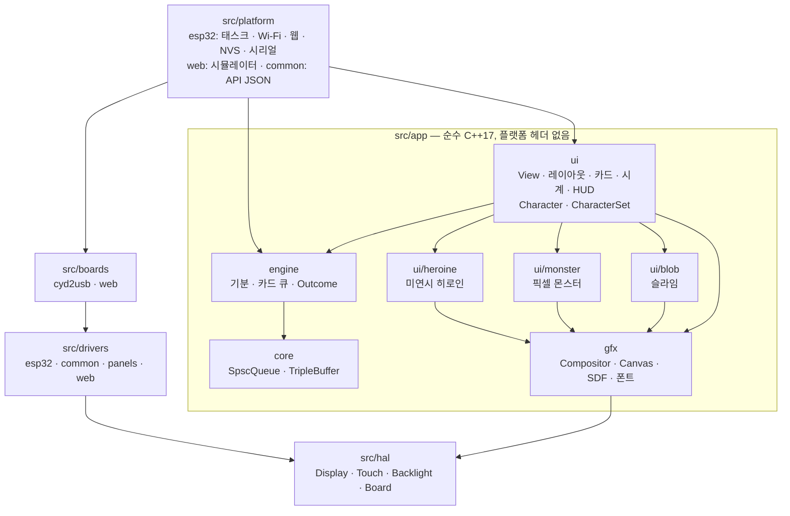
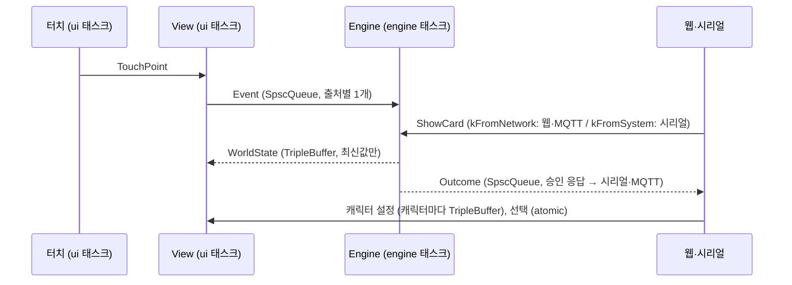
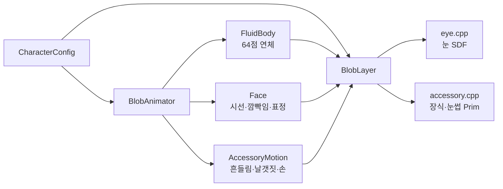

# 시스템 구성 문서

CYD2USB(ESP32) 위에서 동작하는 **캐릭터 + 알림 펌웨어**의 전체 구성을 설명합니다.
대상 버전은 슬라임 캐릭터(git 태그 `slime`)와 그 이후 `main`입니다.
작업 이어받기는 [HANDOFF.md](HANDOFF.md), 사용 방법은 [README.md](../README.md)를 보세요.

---

## 1. 목표와 요구사항

### 1.1 제품 목표

책상 위에 두는 작은 화면 기기입니다. **2D 캐릭터가 화면 안에 살아 있고**, Wi-Fi로 서버와 연결되어 알림을 띄우고 승인 요청에 답합니다.

### 1.2 확정된 요구사항

| 분류 | 요구사항 | 반영 위치 |
|---|---|---|
| 주 기능 | 캐릭터 표시, 서버 알림 표시, 승인·거절 같은 응답 | engine(카드 큐, Outcome), ui(레이아웃, 카드) |
| 렌더러 | LVGL 대신 **자체 경량 렌더러**로 성능 최적화 | gfx/Compositor |
| 분리 | **디스플레이 코드와 내부 엔진 분리** | engine은 픽셀을 모름, ui가 변환 |
| 이식성 | 다른 화면·보드로 시험할 때 **수정이 아니라 추가나 설정 변경**으로 끝나야 함. SoC도 바뀔 수 있음(Nordic 등) | `app/`은 플랫폼 독립, hal/drivers/boards 분리 |
| 레이어 | 2D여도 레이어 구조 | Compositor z-order |
| 성능 | Wi-Fi·서버 통신을 고려한 여유 확보 | 예산: UI 코어 ≤ 50%, 힙 ≥ 100 KB (Wi-Fi + 평문 MQTT 기준, TLS·OTA는 따로, 11.1) |
| 입력 | 지금은 터치. 나중에 물리 버튼, 마이크 | hal::Touch, 의미 이벤트 |
| 기능 | SD카드, 오디오, Wi-Fi, 절전·배터리(USB와 배터리 겸용) | 로드맵 (Wi-Fi AP·설정 웹, 집 Wi-Fi, MQTT는 구현됨) |
| Wi-Fi 설정 | 앱이나 웹으로 폰에서 설정 | 기기 AP + 설정 웹 (BLE는 RAM 문제로 보류) |
| 캐릭터 (슬라임) | 유체 느낌의 몸, 단색 배경, 중앙에 둠 | ui/blob |
| 동작 (슬라임) | 알림이 오면 자리를 비워주며 위로, 승인 요청이 오면 왼쪽으로 이동. 이동은 "스~윽 텅" | View 레이아웃, BlobAnimator glide |
| 이동 모양 (슬라임) | 이동할 때만 동그란 머리와 길게 늘어지는 꼬리. 평소 물성은 유지 | 꼬리 스프링(이동 경로 기준), 머리 관성 감소 |
| 커스터마이징 | 눈 크기와 형태 여러 개, 안광(시선과 눈꺼풀을 따라감), 눈썹 유무와 종류, 몸 형태, 장식(머리·등·양손), 프리셋, 커스텀 웹 | eye, accessory, body_shape, presets, 웹 |
| 캐릭터 (픽셀 몬스터) | 포켓몬 같은 2D 픽셀 몬스터. 평소엔 돌아다니고, 알림이 오면 모드가 바뀜. 승인·선택은 기술을 쓰듯이, 일반 알림은 아래 대화창. 스타팅 3종(불꽃·풀·물, 1세대 느낌의 오리지널) 중 고름 | ui/monster, Character::presentsCards |
| 캐릭터 (애니: 미연시 히로인) | 비주얼 노벨 화면. 방 창가의 바스트업 초상화(사용자가 이미지 모델로 만든 그림)가 숨쉬고 고개를 기울이고 깜빡임. 알림·승인 요청·선택지·대답은 모두 하단 대화창. 대화창이 떠도 캐릭터는 제자리 | ui/heroine, tools/rig |
| 한글 | 알림·승인 요청의 한글 표시 | gfx/font + fonts/ko11 (갈무리11, KS X 1001 2,350자) |
| 시계 | 기본으로 시계 표시 | View ClockLayer, 설정 페이지가 시간을 빌려줌 |
| 버전 관리 | 번호가 아니라 **캐릭터 이름**으로 버전 구분(슬라임, 픽셀 몬스터, 애니). 펌웨어 하나에서 전환 | 태그 `slime` `monster` `anime`, ui::Character + CharacterSet |

---

## 2. 하드웨어

| 항목 | 사양 |
|---|---|
| 보드 | ESP32-2432S028R **CYD2USB** (micro-USB + USB-C, CH340) |
| SoC | ESP32-D0WD-V3 rev3.1, Xtensa LX6 240 MHz × 2, SRAM 520 KB, **PSRAM 없음** |
| 플래시 | 4 MB |
| 화면 | 2.8" 320×240 TFT, ILI9341 호환, SPI(HSPI 네이티브 핀). 이 패널은 **색 반전(INVON)**이 필요함 |
| 터치 | XPT2046 감압식(저항막), 싱글 터치 |
| 기타 | RGB LED(4/16/17, active low), 조도 센서(GPIO34), 스피커 DAC(GPIO26), microSD(VSPI 기본 핀), BOOT 버튼(GPIO0) |

### 2.1 핀과 버스

```
HSPI(SPI2) ─ LCD   : SCLK 14, MOSI 13, CS 15, DC 2, (RST = EN), BL 21 (LEDC PWM)
비트뱅      ─ 터치  : CLK 25, MOSI 32, MISO 39, CS 33, IRQ 36
VSPI(SPI3) ─ SD카드: SCK 18, MISO 19, MOSI 23, CS 5   (미사용, 예약)
```

터치와 SD는 둘 다 VSPI 하드웨어를 쓰지만 핀이 서로 다릅니다. 그래서 터치는 비트뱅으로 돌리고 VSPI는 SD카드용으로 남겨 둡니다.

### 2.2 플래시 파티션 (`min_spiffs.csv`)

| 영역 | 주소 | 크기 | 용도 |
|---|---|---|---|
| bootloader | 0x1000 | – | |
| partitions | 0x8000 | – | |
| nvs | 0x9000 | 20 KB | 캐릭터 설정 JSON (`cyd` 네임스페이스, 캐릭터마다 키 하나 + `active`) |
| otadata | 0xE000 | 8 KB | |
| app0 | 0x10000 | 1.9 MB | 펌웨어 (현재 약 1.63 MB, 83%. 한글 폰트 약 75 KB, 히로인 초상화 약 390 KB와 방 약 48 KB 포함) |
| app1 | – | 1.9 MB | OTA용 (미사용) |
| spiffs | – | 128 KB | 미사용 |

### 2.3 RAM 사용 (실측)

| 항목 | 크기 |
|---|---|
| 정적 RAM(.data/.bss) | 약 89 KB (캐릭터 세 개, 한글용 카드 버퍼 포함) |
| 줄 버퍼 (DMA) | 2 × 15 KB (320 × 24줄 × 2 B) |
| Wi-Fi AP + 웹 서버 | 약 80 KB |
| **여유 힙** (AP·웹 켠 상태) | **약 147 KB** (히로인 활성). 슬라임 태그 때는 163 KB |

---

## 3. 소프트웨어 계층



### 3.1 의존 규칙

- `app/`은 Arduino, ESP-IDF, FreeRTOS 헤더를 포함하지 않습니다. 외부 라이브러리는 헤더 전용이고 이식 가능한 ArduinoJson 하나만 씁니다.
- `engine`은 픽셀, 좌표, 화면을 모릅니다. "기분", "카드", "탭 했음" 같은 **의미 단위**로만 동작합니다.
- `ui`는 엔진 상태를 읽어 화면 표현을 만들고, 터치를 의미 이벤트로 바꿉니다.
- 화면이 무엇인지는 `hal::Display` 인터페이스로만 압니다.
- 보드마다 다른 것(핀, 드라이버 선택, 회전·반전)은 `boards/<이름>/board.cpp` 한 파일에 모읍니다.
- 시간(`millis`), 태스크, 메모리 종류(DMA) 같은 실행 환경은 `platform/`이 맡습니다.

### 3.2 디렉터리

```
src/
  app/core/          spsc_queue.h, triple_buffer.h, utf8.h
  app/engine/        world.h(상태 모델), events.h, engine.{h,cpp}
  app/gfx/           geometry.h, color.h, canvas, compositor, sdf.h, font5x7.h, font(비례 폭 UTF-8),
                     fonts/ko11.cpp(한글 표, 변환 결과)+LICENSE-Galmuri.txt, pixel_art.h, gfx_bench,
                     rle_image(미리 그린 배경), span_image(미리 그린 초상화)
  app/ui/            view, layers(배경·HUD·시계·카드), character.h, characters, expression,
                     hangul.h(조사), json_fields.h(설정 코덱 공용)
  app/ui/blob/       fluid_body, blob_animator, blob_layer, eye, accessory, body_shape,
                     blob_style.h(CharacterConfig), character_json, character_presets, slime_character
  app/ui/monster/    monster_sprites(+monster_art.h, 생성), monster_layers, monster_character, monster_style.h, monster_json
  app/ui/heroine/    heroine_character, heroine_layers, heroine_style.h, heroine_json,
                     heroine_portrait·heroine_room(생성된 표)
  hal/               display.h, touch.h, backlight.h, board.h
  drivers/esp32/     mipi_dcs_spi_display(esp_lcd DMA), ledc_backlight
  drivers/common/    xpt2046_bitbang
  drivers/panels/    panel_desc.h, ili9341.h, st7789.h (초기화 테이블)
  drivers/web/       canvas_display, pointer_touch (시뮬레이터)
  platform/common/   api_json (설정 API의 JSON, 모든 전송 경로가 공유), sample_cards (테스트 카드)
  platform/esp32/    main.cpp, config_store, network(집 Wi-Fi + MQTT), web_server, web_page.h, perf_probe
  platform/web/      main.cpp, index.html (시뮬레이터)
  boards/cyd2usb/    board.cpp
  boards/web/        board.cpp (시뮬레이터: 320×240 캔버스)
  tools/hw_test/     TFT_eSPI 하드웨어 테스트 (env hw_test)
  tools/replay/      결정적 재생 테스트 (env replay, 두 빌드의 화면을 프레임 단위 비교)
tools/serial/        bootlog.py, serial_cmd.py
tools/studio/        serial_studio.py (USB로 설정 페이지)
tools/mqtt/          blob_mqtt.py (시험용 MQTT 브로커 + 카드 보내기·응답 받기, 표준 라이브러리만)
tools/web/           sim.py (시뮬레이터 빌드·개발 서버)
tools/font/          bdf2font.py (BDF 폰트 → gfx::Font 표)
tools/rig/           2D 그림 세트 → 표: studio.py+studio.html(웹 리그 스튜디오), convert.py(아래 넷을 차례로,
                     바뀐 것만), cutout.py, frames.py, portrait.py, scene.py, rig.py(rig.json 읽기·쓰기)
tools/sprites/       sprites.py (픽셀 스프라이트 시트 PNG → PixelArt 표), pio_hook.py (빌드 전에 실행)
art/heroine/         히로인 그림 세트: 원본, 표정 편집본, room.svg, rig.json(리깅과 도구 설정)
art/monster/         픽셀 몬스터 스프라이트 시트(PNG)와 sprites.json
releases/slime/      바로 올리는 이미지
```

---

## 4. 실행 구조와 데이터 흐름

### 4.1 태스크

| 태스크 | 코어 | 우선순위 | 주기 | 하는 일 |
|---|---|---|---|---|
| engine | 0 | 3 | 20 ms (50 Hz) | 이벤트 처리, 기분·카드 상태 전이, 스냅샷 발행 |
| Wi-Fi / httpd | 0 | 시스템 | 이벤트 | AP(+STA), 웹 API, 설정 쓰기, 카드 주입 |
| mqtt_task (esp-mqtt) | 고정 안 됨 | 1 | 이벤트 (최대 1초 대기) | 브로커 연결·재연결, 카드·시간 받기, Outcome·상태 보내기 |
| ui | 1 | 2 | 16 ms 또는 33 ms (적응형) | 터치 → 의미 이벤트, 설정 반영, View 갱신, 렌더 |
| loop (Arduino) | 1 | 1 | 10 ms | 시리얼 명령, BOOT 버튼, Outcome 출력·MQTT로 보내기, 통계, 네트워크 관리(`net::poll`, 0.5초마다) |

- mqtt_task는 미리 빌드된 IDF에 코어 지정 옵션이 없어서 어느 코어에서나 돕니다. 우선순위를 UI(2)보다 낮은 1로 둬서 코어1에 올라와도 남는 시간만 씁니다(TLS 핸드셰이크 포함).
- 네트워크 관리를 따로 태스크로 두지 않은 이유: 스택 4 KB가 TLS에 필요한 힙에서 나가기 때문. 하는 일은 0.5초마다 상태 확인뿐이고, 브로커 설정이 바뀔 때만 이전 클라이언트가 멈출 때까지 loop를 잠깐 붙잡습니다.

### 4.2 스레드 간 통신

락 없이 주고받는 것이 원칙입니다. 서로 기다리면서 프레임이 멈추는 일이 없게 하기 위해서입니다.



| 통로 | 형태 | 생산자 → 소비자 |
|---|---|---|
| 이벤트 입력 | `SpscQueue<Event, 8>` × 3 | ui / 시스템(loop) / 네트워크(httpd와 mqtt_task, 생산자가 둘이라 뮤텍스로 한 번에 하나씩: `postFromNetwork`) → engine |
| 상태 스냅샷 | `TripleBuffer<WorldState>` | engine → ui |
| 응답 결과 | `SpscQueue<Outcome, 8>` | engine → loop → MQTT 보낼 목록(`esp_mqtt_client_enqueue`, 막히지 않음) |
| 네트워크 설정 | 뮤텍스 + 세대 번호(atomic) | httpd·loop가 쓰고 → loop(`net::poll`)가 적용 |
| 캐릭터 설정 | 뮤텍스(쓰는 쪽끼리만) + 캐릭터마다 `TripleBuffer<설정>` (`CharacterWith::publishSettings`) | httpd·loop → ui |
| 활성 캐릭터 | `std::atomic<int>` (ConfigStore) | httpd·loop → ui |
| 시계 | `std::atomic<int32_t>` 하루 안의 시간 차이(가동 시간 기준) | httpd·loop → ui |

### 4.3 한 프레임의 흐름 (ui 태스크)

1. **설정:** `View::syncCharacter(active)` → 캐릭터가 바뀌었으면 전환, 새로 발행된 설정이 있으면 적용. 시계 갱신
2. **표정 미리보기:** 요청이 있으면 적용
3. **터치:** `ui::TouchGesture`가 프레임마다 읽은 값을 동작으로 바꿈. 롱 프레스 기준 전에 떼면 탭: 뗄 때 닿았던 자리로 `View::handleTap` → 의미 이벤트를 엔진에 보냄. 슬라임은 그 자리에 물결을, 픽셀 몬스터는 폴짝 뛰거나 그 자리로 걸어감. 캐릭터를 누른 채 롱 프레스 기준(기본 0.5초, 보정 메뉴의 "롱 프레스 보정"으로 재서 `touchcal`에 저장)만큼 드래그 기준 안에서 있으면 탭 대신 길게 누르기 → `Character::longPress`가 직접 반응하지 않으면 다음 표정을 2.5초 보여 줌(슬라임은 표정 대신 움찔: 들고 다니기 준비). 드래그 기준(기본 16 px, 보정 메뉴의 "드래그 보정"으로 재서 `touchcal`에 저장)을 넘게 움직이면 드래그(길게 누른 뒤면 `HeldDragStart`로 시작): 캐릭터 위에서 시작했으면 `Character::grab/drag/release`로 움직이고, 놓으면 원래대로 돌아감. 슬라임은 그냥 끌면 잡은 곳과 둘레만 늘어나거나 눌리고(몸 넓이 유지), 길게 누른 뒤 끌면 몸째 따라오다 놓으면 미끄러져 돌아감. 몬스터는 어느 쪽이든 들려서 따라오다 걸어서 돌아감. 동작 처리는 `View::handleGesture`. 패널이 누르는 중에도 가끔 값을 놓쳐서 50 ms 동안 안 닿아야 뗀 것으로 봄
4. **상태:** `Engine::pollState`로 최신 스냅샷을 받음
5. **화면 갱신:** `View::update` → 레이아웃 기준점, 카드 위치, 캐릭터 애니메이션, 레이어 갱신
6. **렌더:** `Compositor::render` → 바뀐 영역만 그리고 DMA로 보냄
7. **다음 주기:** `wantsFullFrameRate`면 16 ms, 아니면 33 ms

---

## 5. 엔진 (`app/engine`)

### 5.1 상태 모델 (`world.h`)

```text
WorldState
  timeMs
  character : mood(Idle | Happy | Alert), moodSinceMs
  card      : id, visible, changedMs, chosen, content
  queued
CardContent : kind(Notification | Prompt), sticky, ref, title[49], body[193], optionCount, options[3][25]
              (UTF-8 바이트. 한글 16 / 64 / 8자. 자를 때는 글자 경계에서: core::copyUtf8)
Outcome     : ref, option (-1 = 만료)
```

### 5.2 규칙

| 상황 | 동작 |
|---|---|
| 카드 도착 | 큐에 넣음 (최대 6개). **승인 요청은 알림보다 앞에** 섬. 큐가 꽉 차면 가장 오래된 알림부터 버림 |
| 카드 표시 | 이전 카드가 사라지고 450 ms 뒤에 표시. 기분은 Alert |
| 알림 | 탭하면 닫힘. 6초가 지나면 자동으로 닫힘 |
| 승인 요청 | 버튼을 누르면 Outcome(ref, option)을 내보내고, 누른 버튼을 220 ms 보여준 뒤 닫음. 기분은 Happy. 60초 동안 응답이 없으면 Outcome(-1) |
| `sticky` 카드 | 자동으로 닫히거나 만료되지 않음: 알림은 탭해야, 승인 요청은 답해야 닫힘. 부팅 때 접속 안내 카드가 이것(사용자 요청). 터치가 없는 보드에서는 닫을 수 없으니 안내 카드도 보통 알림으로 |
| 캐릭터 탭 | Happy (1.5초) |
| Alert | 1.5초 뒤 Idle |

---

## 6. 렌더러 (`app/gfx`)

### 6.1 픽셀 형식

- RGB565를 **패널이 받는 바이트 순서**(SPI는 빅엔디언, 그래서 swap)로 저장합니다. 그려진 버퍼를 변환 없이 바로 DMA로 보냅니다.
- 색 합성(`mix`)은 565의 채널을 32비트 레인에 펼쳐서 곱셈 한 번으로 처리합니다. 같은 색으로 반복 합성할 때는 `MixTo`로 색을 미리 펼쳐 둡니다.

### 6.2 Compositor

- **레이어:** 최대 24개. z값이 큰 것이 위에 그려집니다. 레이어는 자기 영역(bounds)이 바뀌거나 내용이 바뀌면 그 영역을 "더러움"으로 표시합니다.
- **바뀐 영역 관리:** 최대 8개 사각형을 둡니다. 합쳤을 때 늘어나는 넓이가 1024 px 이하이면 합칩니다. 바뀐 넓이가 화면의 75%를 넘으면 전체 화면을 한 번에 다시 그립니다.
- **줄 버퍼 파이프라인:** 바뀐 영역을 버퍼 크기만큼의 줄 묶음으로 나누고, 버퍼 두 개를 번갈아 씁니다.

```
CPU: [묶음0 그리기][묶음1 그리기][묶음2 그리기]...
DMA:             [묶음0 전송  ][묶음1 전송  ]...
```

- 묶음 하나를 그릴 때는 그 영역에 걸친 레이어를 아래에서 위로 전부 다시 그립니다. 그래서 겹친 물체나 반투명이 있어도 깨지지 않습니다.
- 첫 레이어(배경)는 불투명하게 화면 전체를 덮어야 합니다.

### 6.3 Canvas와 도형

- **Canvas:** 현재 묶음에 잘린 그리기 표면입니다. 사각형, 둥근 사각형, 세로 그라데이션, 어둡게 하기, 팔레트 스프라이트(확대·반전), 5×7 텍스트, 비례 폭 UTF-8 텍스트(앞 N글자만 그리기 가능: 타자 효과)를 지원하고, 줄 단위 직접 접근(`rowPtr`)도 제공합니다.
- **폰트(`font`):** 코드포인트 정렬 표 + 글리프(advance, 크기, 오프셋) + 한 줄로 이은 비트 스트림입니다. 이진 탐색으로 찾고, 없는 글자는 □로 그립니다. `wrapText`는 공백에서 줄을 바꾸고 넘치면 "..."로 끝냅니다.
  - `kFontKo11`: 갈무리11(SIL OFL 1.1)을 `tools/font/bdf2font.py`로 변환한 것입니다. ASCII, KS X 1001 한글 2,350자, 자모, 기호 두 줄, 베트남어 글자 134자로 2,837글자, 줄 높이 15 px, 약 77 KB입니다. 줄 높이는 한글 기준이고, 베트남어 대문자의 겹친 성조 기호는 줄 위로 최대 5 px(`Font::above`) 올라가므로 `drawText`가 그만큼 위 띠에서도 그립니다. 베트남어는 카프리가 묻는 사람의 언어로 답하기 때문입니다. 라이선스는 `gfx/fonts/LICENSE-Galmuri.txt`에 함께 둡니다.
- **`PixelArt<W,H>`:** 문자 격자(그림 한 줄 = 문자열 한 줄)를 컴파일 때 팔레트 번호 배열로 바꿉니다. constexpr라 정적 초기화 순서 문제가 없습니다. 스프라이트 시트 변환기(8b.4)가 이 형식으로 써서, 그림을 바꾸면 diff에서 그림으로 보입니다.
- **부분 무효화:** `Layer::invalidate(rect)`로 레이어 안 일부만 다시 그리게 할 수 있습니다(타자 효과에서 바뀐 줄만).
- **미리 그린 그림:** `RleImage`(행마다 같은 색 구간, 불투명 배경용)와 `SpanImage`(행마다 빈칸을 건너뛴 텍셀 구간, 그린 그림용. 같은 행은 여러 그림이 공유). `SpanPalette`는 2×2 순서 디더를 넣은 색 표 4벌을 받습니다.
- **SDF(`sdf.h`):** 원, 회전 타원, 캡슐, 삼각형, 하트, 별의 거리 함수와 범용 칠하기(`paint`)가 있습니다.
  - `paint`는 거리값을 이용해 **바깥 구간은 건너뛰고, 안쪽 깊은 구간은 계산 없이 채웁니다**. 계산량이 넓이가 아니라 둘레에 비례합니다.
  - 타원 근사식은 실제 거리를 과대평가하지 않게 만들어서, 건너뛰어도 안전합니다.

### 6.4 그리기 비용 (`bench`, CPU만, 240 MHz)

| 연산 | cycles/px |
|---|---|
| 단색 채우기 | 1.3 |
| 그라데이션 | 1.5 |
| 4배 확대 스프라이트 | 15.5 |
| 회전+확대 스프라이트(시제품) | 16.0 |
| 그림자 | 23.3 |
| 반투명 합성 | 25.2 |
| 텍스트 | 32.6 |
| **SPI 40 MHz 전송** | **2.5 Mpx/s** (전체 화면 30.7 ms) |

**병목은 CPU가 아니라 SPI입니다.** 그래서 설계 방향은 "바뀌는 넓이를 줄이는 것"입니다. CPU는 꽤 비싼 효과도 감당할 수 있습니다.

---

## 7. UI (`app/ui`)

### 7.1 캐릭터 인터페이스 (`character.h`, `characters`)

View는 캐릭터를 `ui::Character` 인터페이스로만 다룹니다. 두 쪽으로 나뉘고 쓰는 스레드가 다릅니다.

| 쪽 | 메서드 | 스레드 |
|---|---|---|
| 설정 | `resetSettings`, `mergeSettings(JsonObjectConst)`, `applyPreset`, `settingsToJson(JsonObject)`, `publishSettings`, `describe`(웹용 목록) | 쓰는 쪽(웹·시리얼), ConfigStore 뮤텍스 아래 |
| 화면 | `attach(comp, z, w, h, seed)`, `setActive`, `syncSettings`, `background`, `setAnchor`, `setAttention`, `previewExpression`, `update`, `hitTest`, `poke`, `busy` | UI 태스크 |
| 카드를 직접 연출 | `presentsCards`, `present(card)`, `handleTap` (기본은 쓰지 않음) | UI 태스크 |

- **`CharacterWith<설정>`:** 설정이 구조체 하나인 캐릭터의 공통 부분입니다. 쓰는 쪽 사본(`edited_`), 트리플버퍼, 화면 쪽 사본(`settings_`)을 가집니다. `publishSettings`가 넘기고 `takeSettings`가 받습니다.
- **`CharacterSet`:** 캐릭터를 등록하는 유일한 곳입니다. 설정 문서 `{"character":..,"<이름>":{..}}`를 병합·출력하고, 최상위에 캐릭터 이름이 아닌 키가 있으면 예전 슬라임 문서로 보고 기본 캐릭터(0번)에 병합합니다.
- **공통 표정 어휘(`expression`):** normal, happy, surprised, sleepy, angry, sad. 캐릭터마다 자기 방식으로 보여줍니다(슬라임은 눈 모양, 픽셀 몬스터는 말풍선).
- **모든 캐릭터는 항상 붙어 있고**, 활성 캐릭터만 보이고 갱신됩니다. 비활성 레이어는 그리지 않아서 비용이 없습니다. 슬라임은 시드를 그대로 받아서 전환 기능이 없던 때와 똑같이 재생됩니다.

### 7.2 View

- **레이어 구성:** 배경(z0), 캐릭터(z200~299, 캐릭터가 나눠 씀), HUD(z800), 시계(z850), 카드(z900).
- **레이아웃:** 화면 크기와 방향에서 계산하고, 하드코딩된 좌표는 없습니다. 카드를 직접 연출하는 캐릭터(`presentsCards`)이면 View는 공유 카드를 숨기고, 위치도 캐릭터에 맡기고, 카드 상태와 탭을 넘깁니다.

| 카드 | 가로 화면 | 세로 화면 |
|---|---|---|
| 없음 | 캐릭터 중앙 | 캐릭터 중앙 |
| 알림 | 카드는 아래쪽 48% 영역(아래에서 올라옴), 캐릭터는 위쪽 공간 중앙 | 같음 |
| 승인 요청 | 카드는 오른쪽 56% 영역(오른쪽에서 들어옴), 캐릭터는 왼쪽 공간 중앙 | 카드는 아래 55% 영역, 캐릭터는 위쪽 |

- **카드 슬라이드:** 260 ms, ease-out입니다. 캐릭터가 먼저 움직이도록 카드는 70 ms 늦게 출발합니다.
- **시선:** 카드가 떠 있는 동안 캐릭터의 시선은 카드 중심을 향합니다.
- **탭 판정 순서:** 카드(승인 요청이면 버튼) → 캐릭터 몸 → 나머지는 무시.
- **프레임률:** 카드가 슬라이드 중이거나 캐릭터가 바쁠 때(`busy`)는 60 fps, 아니면 30 fps.

### 7.3 카드 (`CardLayer`, 슬라임이 씀)

- 제목, 자동 줄바꿈 본문(넘치면 "..."), 버튼 최대 3개로 구성됩니다.
- 폭이 200 px 이상이면 버튼을 가로로 나란히 두고, 좁으면 세로로 쌓습니다.
- 강조색은 알림이 노랑, 승인 요청이 하늘색입니다. 첫 버튼은 강조색으로 채우고, 누르면 밝게 표시합니다.
- 글자가 모두 ASCII면 5×7 폰트를 예전 그대로 씁니다. 줄바꿈과 자르기도 같은 결과가 나오게 맞췄습니다. 한글이 섞이면 카드 전체를 `kFontKo11`로 그립니다.

### 7.4 시계 (`ClockLayer`)

- 오른쪽 위에 `HH:MM`을 그립니다. 밝은 글자에 어두운 그림자를 넣어서 어떤 배경에서도 읽힙니다. 승인 요청 카드가 오면 카드 밑에 가려집니다.
- 시간을 모르면(-1) 숨깁니다. 시간은 플랫폼이 `View::setClock(분)`으로 넣습니다(9.2).

---

## 8. 슬라임 캐릭터 (`app/ui/blob`)

### 8.1 구성



- 몸 반지름 R은 `size`(0.21) × 화면 짧은 변이고, 이 화면에서 약 50 px입니다. 모든 움직임 상수는 R 기준이라 화면 크기가 달라도 느낌이 같습니다.

### 8.2 FluidBody (연체 물리)

- **표현:** 중심에서 64방향의 반지름 변위로 몸을 나타냅니다.
- **목표 모양:** 기준 실루엣 + 숨쉬기(위아래·좌우 교대) + 꼬리 모양.
- **힘:** 목표 모양으로 돌아가는 스프링(160), 감쇠(5), 이웃 결합인 표면장력(900, 물결이 둘레를 따라 전파됨), 관성(중력 − 중심 가속도) × 0.7.
- **적분:** 최대 1/240초 간격으로 나눠 계산하고, 한 프레임에 최대 12번입니다. 변위는 −0.6R ~ +3.2R로 제한합니다.
- **부피 보존:** 목표 넓이 = 목표 외곽 넓이 − 꼬리 넓이의 25%. 꼬리가 길어져도 머리 크기를 거의 유지합니다.
- **조작:** `poke`(한 지점 물결), `squash`(한 축으로 누르기), `radiusAt` / `restRadiusAt`(표면 위치 샘플).

### 8.3 BlobAnimator (움직임)

- **이동 (glide):** 기준점이 바뀌면 현재 위치에서 시작합니다.
  - 시간은 `glideMs`(260) × clamp(0.6 + 0.4·거리/2R, 0.6, 1.5).
  - 경로는 `s(u) = (1−k)·smoothstep(u) + k·u²`, k = `thud`(0.65). 부드럽게 출발하고 속도가 남은 채 도착합니다.
  - 몸에는 이동 가속을 **12%만** 전달해서 머리가 동그라미를 유지합니다.
- **꼬리:** 꼬리 끝은 이동 경로(통통 튐, 둥실거림 제외)에 스프링으로 매달린 점입니다.
  - 꼬리 길이 = 뒤처진 거리 × `drop`(1.6), 최대 3R.
  - 모양은 끝으로 갈수록 좁아집니다. 폭은 접선 각도 기준으로 0.35~1.2 rad이고, 지수 1.6이라 옆면이 살짝 오목합니다.
  - 스프링 세기는 이동 중 ω4·ζ0.45(뒤가 못 따라옴), 정지 후 ω10·ζ0.85(빠르게 합쳐지고 넘어가지 않음).
  - 멈춘 뒤 꼬리가 앞으로 넘어간 부분은 15%만 모양에 반영합니다.
- **도착 ("텅"):** 도착 속도의 0.18배로 진행 방향을 누르고, 장식은 앞으로 휙 쏠립니다(0.8).
- **통통 튐 (Happy):** 520 ms마다 위로 3.2 R/s의 속도를 줍니다. 세로 오프셋 스프링(ω13·ζ0.38)이고, 이 가속은 몸이 그대로 받아 젤리처럼 출렁입니다.
- **대기:** 둥실거림 0.035R(주기 3.4초), 숨쉬기 0.03R(3.2초), 4~9초마다 작은 물결.
- **얼굴:**
  - 깜빡임: 140 ms, 2.2~6초 간격. 15% 확률로 두 번 연속.
  - 표정 전환: 160 ms 동안 눈 모양 수치를 보간.
  - 놀람: Alert 후 900 ms.
  - 시선: 대기 중에는 무작위로 이동하고, 카드가 있으면 카드를 봄. 초당 9의 속도로 부드럽게 따라감.
- **장식 흔들림:** 부위마다 각도 스프링(k70, c7)이고, 몸 가속을 접선 방향 토크로 받습니다(0.22, 최대 0.7 rad).
  - 날개: 대기 4 rad/s·0.12 rad, 이동 중 18 rad/s·0.35 rad.
  - Happy일 때 손을 흔듭니다.
- **바쁨 (busy):** 이동 중, 기쁨, 꼬리가 남아 있음, 물결이 있음 → 이후 700~900 ms 동안 60 fps를 요청합니다.
- **물방울 (`splash`, 실험, 기본 꺼짐):** 꼬리가 1.6R를 넘으면 끝에서 떨어져 나와 따라오다가 몸에 닿으면 합쳐집니다.

### 8.4 BlobLayer (그리기)

- **외곽선:** 64점 사이에 Catmull-Rom 중간점을 넣어 128점으로 만듭니다.
- **몸:** 외곽선을 한 줄에 세로 4번 샘플링해 경계값 표를 만들고, 안쪽은 불투명도만큼 한 번에 합성(`MixTo`)합니다. 경계 픽셀만 덮인 면적을 계산해 매끄럽게 처리합니다.
- **그리는 순서:** 등 장식·팔·물방울(몸 뒤) → 몸(반투명) → 광택 → 볼 → 눈 → 머리·손 장식·눈썹.
- **얼굴 위치:** 몸 중심에 붙고, 머리 크기에서 크기를 잽니다(최대 1.4R). 꼬리가 길어져도 얼굴이 끌려가지 않습니다.
- **다시 그리기:** 외곽선 이동이 0.2 px 미만이고 얼굴, 장식, 물방울에 변화가 없으면 다시 그리지 않습니다.

### 8.5 눈 (`eye`)

- **EyeShape:** 너비, 높이, 둥근 정도(타원 ↔ 둥근 사각형을 거리 함수 보간), 모서리, 기울기, 위 눈꺼풀(높이·각도, 반평면으로 자름), 아래 눈꺼풀, 아치(아래쪽 타원을 파내서 ^ 모양), 안광 크기, 눈썹 높이·각도.
- **표정:** Normal, Happy, Surprised, Sleepy, Angry, Sad. 눈 세트는 oval / robot / dot / pill (`constexpr`).
- **안광:** 한쪽 빛 방향 기준이라 양쪽 눈에서 같은 쪽에 있습니다. **보이는 눈 영역** 안에 놓여서, 위 눈꺼풀이 내려오면 같이 내려오고 시선 방향으로 움직입니다.

### 8.6 장식·눈썹 (`accessory`)

| 부위 | 종류 | 그리는 위치 |
|---|---|---|
| head | antenna, sprout, bow, ears, horns, crown | 몸 앞 |
| back | wings, fin, spikes | 몸 뒤 (반투명한 몸 너머로 보임) |
| left / right | arm, heart, star, flag, balloon | 팔은 몸 뒤, 들고 있는 물건은 몸 앞 |
| 눈썹 | none, line, arch, thick, dot | 몸 앞 |

- **도형:** 장식은 몸 표면 위 지점에 세운 좌표계(접선 u, 바깥 방향 v)에서 정의합니다. 매 프레임 화면 좌표 도형 목록(`PrimList`, 최대 28개)으로 만듭니다.
- **붙는 위치:** 표면이 출렁이면 같이 움직입니다. 다만 늘어난 꼬리 쪽으로 끌려가지 않도록, 기준 반지름의 1.25배까지만 따라갑니다.
- **설정:** 부위마다 종류, 색 2개, 크기, 외곽선 위 각도(−90~90°)를 정합니다.

### 8.7 몸 형태 (`body_shape`)

- 종류: round, egg, mochi, drop, squircle, cat, bean. 가로세로 비율은 따로 조절합니다.
- 각 형태는 같은 반지름 원과 **면적이 같게** 맞춥니다.
- 형태를 바꾸면 기준 실루엣만 바꾸고 몸을 리셋하지 않아서, 새 모양으로 흘러가듯 바뀝니다.

### 8.8 설정과 프리셋

- **`CharacterConfig`:** size, bodyShape, aspect, background, style(색·불투명도·광택·볼·눈 배치·시선·안광 이동), eyeSetName, eyes[6], brows, accessories[4], physics, motion.
- **JSON 코덱 (`character_json`):** 일부 키만 보내도 병합됩니다. 모든 값은 범위로 제한하고, 색은 `#rrggbb`입니다. `eyeSet`을 보내면 그 세트를 먼저 불러온 뒤 `eyes` 값을 덮어씁니다. 전체 크기는 약 1.8 KB입니다.
- **프리셋 9종 (`character_presets`):** 기본값 위에 덮어쓰는 JSON입니다. 외부 캐릭터 변환기나 서버가 만든 결과도 같은 형식이면 그대로 프리셋이 됩니다.
- **`SlimeCharacter`:** 위 부품들을 `ui::Character`로 감쌉니다. 설정은 `CharacterConfig`이고 JSON은 예전 그대로라서 태그 때 저장한 NVS와 프리셋이 그대로 읽힙니다. 공유 카드와 레이아웃을 씁니다.
- **고정:** 동작은 git 태그 `slime`과 같아야 합니다. 공유 코드를 바꾸면 재생 테스트(9.4)로 확인합니다.

---

## 8b. 픽셀 몬스터 캐릭터 (`app/ui/monster`)

포켓몬 같은 2D 픽셀 몬스터입니다. 공유 카드를 쓰지 않고 카드를 직접 연출합니다(`presentsCards`).

**스타팅 3종 (`Species`):** 엔진, 레이어, 상태 기계는 하나를 같이 쓰고 그림, 색, 기술 연출만 종마다 다릅니다. 종을 더해도 RAM과 레이어는 늘지 않고 플래시만 약 3 KB 늡니다. 그림은 1세대 스타팅의 원형만 빌린 오리지널이고, 셋 다 목도리를 둘렀습니다.

| 종 | 기본 이름 | 생김새 | 기술 파편 |
|---|---|---|---|
| fire | 엠버 | 불꽃 꼬리 도마뱀, 파란 목도리. 꼬리 불꽃이 깜빡임 | 불꽃(네모, 불꽃색) |
| grass | 잎새 | 등에 잎 두 장이 난 네발 새싹, 노란 목도리 | 잎사귀(더 크고 느리게 흩날림) |
| water | 방울 | 둥근 등껍질 거북, 지느러미 꼬리, 빨간 목도리. 잘 때 등껍질 속으로 | 물방울(동그라미, 몸색·흰색) |

### 8b.1 장면

| 상황 | 화면 |
|---|---|
| 평소 (필드) | 위에서 본 풀밭(16×16 타일 × 픽셀 크기 3, 시드로 꽃과 키 큰 풀 배치). 몬스터가 x 먼저, 그다음 y로 격자처럼 걷습니다(2프레임). 가끔 두리번거리거나 생각합니다(…). 30초 동안 일이 없으면 웅크리고 잡니다(zZ). 몬스터를 탭하면 폴짝(♥), 풀밭을 탭하면 그 자리로 걸어갑니다 |
| 알림 | 멈추고 머리 위 "!"(0.45초) → 아래 대화창이 올라옴 → 제목(주황)과 본문이 한 글자씩 → ▼ 깜빡임. 대화창을 탭하면 닫힘(엔진 TapCard). 몬스터는 대화창 위로 비켜 섭니다 |
| 승인 요청 | "!" → 흰 번쩍 2번 → 줄무늬가 닫혔다 열리며 배틀 화면 → 양쪽이 미끄러져 들어옴 → "야생의 ○○이(가) 나타났다!" → 본문 + 기술 메뉴(선택지 최대 3개) |
| 기술 사용 | 누른 기술이 0.25초 노랗게 → "(이름)의 승인!" → 돌진 → 종별 파편 → 상대 깜빡임 → 결과. 첫 번째 선택지면 HP가 줄고 쓰러지며 "효과는 굉장했다!", 나머지는 "○○는 도망쳤다!", 60초 만료는 "○○는 날아가 버렸다..." → 줄무늬로 필드 복귀(♥ 또는 …) |

- 새 카드가 오면 진행 중인 배틀 마무리를 끊고 바로 새 카드를 처리합니다(엔진의 알림 6초 안에 보여주려고).
- 조사는 `ui/hangul.h`가 마지막 글자의 받침으로 고릅니다. 한글로 끝나지 않으면 "이(가)"처럼 둘 다 씁니다.
- 표정 미리보기: 정면을 보고 말풍선을 띄웁니다(기쁨 ♥ + 폴짝, 놀람 !, 졸림 zZ(잠든 모습), 화남, 슬픔 💧).

### 8b.2 그리기

- **레이어(z200 기준):** 배경 장면(+0), 상대(+10), 상대 이름표(+12), 몬스터(+20), 내 이름표(+22), 기술 파편(+30), 말풍선(+40), 메시지 상자(+50), 전환 효과(+90). 활성일 때만 보입니다.
- **그림:** `art/monster/`의 PNG 시트를 빌드 때 바꾼 `PixelArt` 표입니다(8b.4). 종마다 `Pose` 순서의 프레임 10장(필드 9장 + 배틀 뒷모습). 몬스터는 12색 팔레트이고, 외곽선·그늘·목도리 그늘은 설정 색에서 계산합니다. `accent`/`accent2` 자리는 종의 특징(불꽃, 잎, 등껍질)입니다. 불꽃 스타팅의 꼬리는 140 ms마다 팔레트 두 벌을 번갈아 써서 깜빡입니다(그림은 그대로).
- **비용:** 바뀌는 영역이 작습니다(필드 대기 약 2.5K px/프레임, 코어1 1~4%). 메시지 상자는 글자가 늘어난 줄만 다시 그립니다. 배틀 전환 1초 동안만 전체 화면을 다시 그립니다.
- 픽셀 좌표는 그림 픽셀 단위(픽셀 크기의 배수)로 맞춰서 타일과 어긋나지 않습니다.

### 8b.3 설정 (`MonsterConfig`, `monster_json`)

- 종(species), 이름(UTF-8, 한글 8자), 색 6개(몸, 배, accent, accent2, 목도리, 풀밭), 픽셀 크기(2~4), 걷는 속도, 글자 속도, 잠들기까지 시간, 레벨.
- `species`만 바꾸면 그림만 바뀝니다. 스타팅 프리셋(ember, leaf, bubble)은 `starterConfig`로 그 스타팅의 이름과 색을 함께 가져옵니다. 설정 페이지는 이 셋을 "스타팅 몬스터" 선택으로 보여줍니다.
- **종은 데이터입니다:** 종 목록, 기본 이름·색, 프리셋 이름, 기술 모양(불꽃은 깜빡임도), 특징 이름은 모두 `sprites.json`의 `characters`에서 옵니다. 코드는 종을 번호(`kSpecies`)로만 알고 종마다 갈라지는 곳은 기술 모양(`Move`)뿐이라, 종을 더할 때 코드는 그대로입니다. 설정 페이지도 `/api/meta`의 종 목록으로 그립니다.
- 그 밖의 프리셋: frost(서리), shiny(반짝이), night(밤불). 셋 다 불꽃 스타팅 기반입니다.

### 8b.4 스프라이트 시트 (`art/monster/`, `tools/sprites/sprites.py`)

그림은 코드 밖 PNG입니다(2026-10-26, 사용자 요청 "캐릭터 스프라이트로 관리"). 도트 편집기로 고치고 빌드하면 됩니다.

- **세트:** `sprites.json` 하나와 PNG 시트들. `palettes`는 이름마다 자리를 번호 순서로(0은 투명): 글자 하나, 시트에서 그 자리를 그린 색, 설명(`"o": "#391808 outline"`). `sheets`는 모든 캐릭터가 같이 쓰는 시트: PNG, 팔레트, 프레임 크기, 프레임 이름 격자(행 위→아래, `null`은 빈 칸), 설명(`about`). `characters`는 캐릭터마다 같은 배치의 시트: `sheets`(배치, PNG 이름의 `{id}`가 캐릭터, 칸 이름은 역할 `Down0`), `roles`(역할마다 무엇을 그릴지), `list`(캐릭터마다 `id`, `palette`, 그리고 펌웨어가 쓰는 정보), `type`(생성 표의 C++ 형식).
- **시트:** 종마다 필드 16×16 격자(`fire.png`: 아래·위·옆·들림 × 서기·걷기, 잠)와 뒷모습 32×32(`fire_back.png`), 상대 24×24(`foe.png`), 타일(`tiles.png`), 말풍선(`emotes.png`). 시트의 색은 기본 색(565로 맞춘 값)이라 기기 화면과 같아 보이지만, 실제 색은 설정에서 계산하므로 색은 자리를 고르는 열쇠일 뿐입니다.
- **변환:** 알파 128 미만은 투명, 나머지는 가장 가까운 열쇠 색의 자리. 거리 48을 넘는 색, 격자와 안 맞는 시트 크기, 겹치는 프레임 이름은 위치와 함께 오류(빌드가 멈춤). 시트를 정수배로 키워 그려도 됩니다(각 블록 가운데를 읽음).
- **출력:** `src/app/ui/monster/monster_art.h`(생성, 저장소에 넣음). 팔레트마다 `k<이름>Legend`, 프레임마다 `constexpr gfx::PixelArt<W,H> k<프레임>`(캐릭터 프레임은 `k<Id><역할>`). 캐릭터가 있으면 `enum Role`, 캐릭터마다 역할 순서의 프레임 표, `kCharacters[]`({id, 프레임, 나머지 정보 JSON}), `kCharacterCount`. `monster_sprites.cpp`는 `kSpecies`와 타일·말풍선 표로 묶기만 하고, `Role`과 `Pose`의 순서를 static_assert로 맞춰 봅니다. 팔레트 자리 순서 = `MonColor` 등 펌웨어의 번호.
- **언제:** PlatformIO `extra_scripts = pre:tools/sprites/pio_hook.py`와 시뮬레이터(`sim.py`, `art/`도 감시)가 매 빌드 전에 `build_stale()`: `sprites.json`, 시트, 변환기 중 하나라도 헤더보다 새로우면 다시 만들고, 내용이 같으면 파일은 그대로 두고 시각만 갱신합니다. Pillow가 필요합니다.
- **옮길 때:** 예전 문자 격자 41장을 PNG로 내보내고 다시 변환해 41장 모두 같은 번호임을 확인. 같은 고정 색을 쓰던 자리 두 쌍(상대 날개 끝 = 종이 흰색, 말풍선 잉크 = 외곽선)은 열쇠 색이 겹쳐서 합쳤습니다(`kFoeColors` 8→7, `kEmoteColors` 6→5, 화면은 같음).

---

## 8c. 미연시 히로인 캐릭터 (`app/ui/heroine`)

비주얼 노벨 화면입니다. 방 창가에 선 바스트업 초상화가 화면 아래쪽에 있고, 알림·승인 요청·선택지·대답은 모두 하단 대화창에 나옵니다(`presentsCards`). 대화창이 떠도 캐릭터는 움직이지 않습니다(사용자 요청). 그림은 사용자가 이미지 모델로 만든 것이고, PC 도구(`tools/rig/`, Python + numpy/OpenCV)가 누끼, 표정 프레임, 자세를 미리 만들어 표로 넣습니다. 펌웨어는 그림을 다시 샘플링하지 않습니다.

### 8c.1 그림 파이프라인 (PC)

| 단계 | 도구 | 하는 일 |
|---|---|---|
| 누끼 | `cutout.py` | 초록 크로마, 단색, 그려 넣은 체크무늬 배경을 자동으로 판별해 지움 |
| 표정 프레임 | `frames.py` | GPT 편집본은 원본과 크기·위치가 달라서, 얼굴을 다중 배율 템플릿 매칭으로 찾고 위치별로 색을 맞춘 뒤 눈·눈썹·입 영역만 원본 누끼에 붙임. 곁눈질은 눈마다 다시 맞춤(크기·위치가 튀지 않게) |
| 자세 굽기 | `portrait.py` | 원본(1024 px 폭)을 메시로 굽혀 고개 기울임 7단계(0.02 rad 간격, ±0.06)를 그림. 4배 슈퍼샘플링 후 기기 크기 384×252. 어깨 위 머리카락은 머리를 따라가고 그 아래 긴 머리는 늘어진 채. 단계마다 표정 프레임 13장은 그 자세와 달라진 픽셀만 남김. 전부 255색 팔레트 하나(k-means, 4×4 순서 디더)로 `SpanImage`에 저장하고, 모든 단계에서 같은 행(가슴 아래 43행)은 한 번만 저장(합계 약 390 KB) |
| 방 | `scene.py` | SVG를 시간대 4개 색으로 미리 그림(RLE, 약 48 KB) |

그림과 리깅은 한 세트입니다: `art/heroine/`의 원본·편집본·`room.svg`와 `rig.json`(얼굴 영역, 표정 목록, 자세 굽기 설정, 방 색; `tools/rig/rig.py`). 변환기 `tools/rig/convert.py art/heroine`이 위 네 단계 중 입력이 바뀐 것만 차례로 돌립니다. 단계의 입력은 파일과 도구 스크립트, 그리고 rig.json 중 그 단계의 몫이고, 단계마다 마지막으로 쓴 설정을 `<세트>/.convert.json`에 남겨서 피벗을 옮기면 자세만 다시 굽습니다(11~20초, 전부는 5분 20초). 빌드와 따로 돌리는 이유는 OpenCV가 필요하고 오래 걸려서입니다. 결과 표는 저장소에 넣습니다.

**리그 스튜디오** (`tools/rig/studio.py`, 표준 라이브러리 HTTP 서버 + `studio.html` 한 장, 기본 http://localhost:8770): 단계(그림 → 누끼 → 고개 → 얼굴 → 표정 → 변환, 고급)를 따라 세트를 만듭니다. 그림 단계는 넣을 그림을 예시와 체크리스트로 보여 주고, 표정 단계는 펌웨어가 쓰는 13개 표정(`SLOTS`, 프레임 순서와 같음)을 카드 하나씩으로 보여 줍니다(설명, 예시 얼굴, 이미지 모델 부탁 문장, 올린 그림, 맞춘 얼굴). 그림 위에서 리깅 값을 끌어서 정합니다(행은 가로선, 피벗·얼굴 창·타원은 손잡이, 그 단계의 것만). 도트 스프라이트 세트도 같은 화면에서 공통 시트, 캐릭터마다 필요한 것(배치, 칸마다 그릴 것), 캐릭터별 시트와 정보를 보고 고치며, 캐릭터를 빈 시트로 또는 다른 캐릭터의 그림을 복사해 추가하거나 뺄 수 있습니다(팔레트는 .gpl로 내려받아 편집기에서 씀). 올린 시트나 바꾼 정보는 바로 변환해 보고 안 맞으면 되돌립니다(`sprites.save`가 `sprites.json`을 씁니다). rig.json의 자세 값은 기기 px, 얼굴 값은 원본 px라서 화면은 원본 위에 `원본 y = 자르기 위 + 기기 y / 배율`로 그리고, 자르기나 기기 높이를 바꾸면 리깅이 그림 위 그 자리에 남도록 기기 값을 다시 계산합니다. 미리보기는 저장하지 않은 리깅을 서버로 보내 `portrait.Warp`로 기울임 한 단계를 기기 크기로 그리고(약 1초), 머리를 따라오는 정도(`head_weight`)를 겹쳐 보입니다. 방은 시간대마다 `scene.Scene.render`로. 저장은 `rig.dump`(한 줄에 맞으면 한 줄)라 손으로 고친 것과 diff가 작고, 같은 내용이면 파일을 건드리지 않습니다. 누끼·변환은 서버가 하위 프로세스로 하나씩 돌리고 로그를 보여 줍니다.

### 8c.2 실행 중 (펌웨어)

- **자세:** 고개 기울임은 스프링으로 움직이는 값을 가장 가까운 그려 둔 단계로 고릅니다. 반 단계를 조금 넘어야 바뀌어서 두 단계 사이에서 떨지 않습니다. 숨쉬기, 끄덕임, 놀람, 시무룩은 머리와 어깨를 정수 px만큼 올리거나 내리고, 가슴 행(172행부터 화면 아래까지)이 늘어나거나 줄어서 메웁니다. 기쁠 때는 전체가 폴짝 뜁니다. 자세는 초당 최대 12번(83 ms)만 바꾸고, 바뀌었을 때만 다시 그립니다.
- **표정:** 눈(또는 얼굴 전체) 패치와 입 패치를 지금 기울임 단계의 것으로 골라 자세 위에 그립니다. 3단 깜빡임, 곁눈질, 말할 때 입 모양, 쓰다듬기(그쪽으로 기울임), 찌르기, 졸기가 있습니다.
- **그리기:** 행 단위 복사뿐입니다(`gfx::drawSpanRow`: 행마다 구간 몇 개, 텍셀마다 팔레트 하나를 읽음). 다시 샘플링하지 않으니 삼각형 이음새나 반짝임이 없습니다.
- **색:** 팔레트는 RAM에서 패널용 채도·감마를 적용하고, 565로 줄일 때 2×2 순서 디더를 넣은 표 4벌(2 KB)로 만듭니다. 디더는 그림 좌표에 고정되어 그림과 같이 움직입니다. 매끈한 피부 그라데이션이 565와 팔레트 단계에서 회색 등고선처럼 보이던 것을 PC(팔레트)와 기기(565) 두 단계 디더로 없앴습니다.
- **레이어(캐릭터 z 기준):** 방(+0), 초상화(+20), 대화창(+50). 활성일 때만 보입니다.

### 8c.3 설정 (`HeroineConfig`, `heroine_json`)

- name(이름표, 한글 8자), accent(이름표·선택지 색), time(auto/morning/day/evening/night), textMs(타자 속도), sleepAfter(졸기까지 초), saturation(기본 1.3), gamma(기본 1.1). 채도와 감마는 TN 패널 보정이고 팔레트에만 적용되어 그리기 비용이 없습니다.

## 8d. Capri 캐릭터 (`app/ui/capri`, 2026-10-30)

Cyberpunk: Edgerunners의 Capri(팬 캐릭터). 그림은 mochiiwuff/capri-desktop, 목소리(성격·대사·인사 음성)는 lachydotmcg/capri-desktop에서 가져왔습니다(둘 다 PolyForm Noncommercial, 출처와 권리는 `art/capri/CREDITS.md`). 카드를 직접 연출합니다(`presentsCards`).

- **그림(PC, `tools/capri/convert.py`, Pillow + numpy):** 몸은 capri-desktop의 인트로 클로즈업 `intro-*.webp`(1672×941, 화면 가장자리를 잡은 그녀) 셀 9장: grab(쉼), happy(웃는 눈), mouth1~3(말할 때 입), smear(휘두르는 팔), wave1~3(인사). 셀마다 바뀌는 영역(입·눈·오른팔, capri-desktop `build-intro.py`의 CHANGES)만 그 셀에서, 나머지는 grab에서 가져와(손실 WebP 잡음이 셀마다 달라 행 공유가 깨지므로) 폭 480·320·240 세 크기로 줄이고, 255색 팔레트 하나(불투명도 4단계) `SpanImage`, 같은 행은 한 번만 저장. 셀마다 grab과 다른 행 범위(`kCelChanged`)를 남겨 셀을 바꿀 때 그 행만 다시 그림(입 약 84행). 패널 얼굴 8장(64 px)과 컷인 5장(192×128)은 각자 256색 `RleImage`, 인사 음성 3개는 16 kHz 16비트. 합계 플래시 약 1.4 MB(JC 전체 3.47/6.55 MB). 전신 누끼(`capri-cutout`, `capri-full`)는 사용자 요청으로 뺌(2026-10-30).
- **레이어(z 기준):** 밤하늘(+0: 그라데이션, 3줄마다 스캔라인, 별 48개, 가끔 지나가는 위성), 몸(+20), 패널(+50), 컷인(+70). 레이어 4개라 전체 23/24.
- **몸:** 화면 폭에 맞는 가장 큰 크기를 위쪽에, 패널은 늘 아래(손·몸 위로 겹침). 행 단위 이동만 함: 대기 둥실(0/−2/−4/−2 px), 위 40% 갈기 흔들림, 글리치(행 띠 3개 + 시안/빨강 잔상). 셀: 글자가 디코딩되는 동안 입(mouth1→2→3→2, 90 ms), 인사·start 카드에 손 흔들기(wave 140 ms × 6), 쓰다듬기·grin/laugh 얼굴에 웃는 눈 1.4초, 찌르기에 팔 휘두르기(smear 260 ms). 패널이 열릴 때 짧은 글리치. 졸면 팔레트를 밤색 쪽으로 0.45 섞음.
- **패널:** 원래 앱 두 개의 말풍선을 합친 모양: 어두운 판(#090B0F, 3줄 스캔라인), 오른쪽 위·왼쪽 아래를 깎은 모서리, 2 px 테두리(태그 색), 왼쪽 빨간 막대, 보라색 그림자, 깎은 액자 속 얼굴, 상태 배지, `> sys: <제목>`, 빨간 `CAPRI:`, 파란 본문이 글자마다 디코딩(앞쪽 끝 2글자는 잡음 글리프), 끝나면 블록 커서. 패널은 글 높이에 맞춰 줄어듦. 승인 요청은 깎은 버튼.
- **카드 스타일:** 카드 JSON의 `tag`(engine `CardContent::tag`, 다른 캐릭터는 무시): `info alert done error work remind idle start end chat` → 배지(SYNC/WAITING/DONE/ERROR/RUNNING/REMINDER/IDLE/ONLINE/OFFLINE/CAPRI), 테두리 색, 얼굴, 컷인, 소리, 첫 줄(그녀의 말, `capri_lines`). 태그가 없으면 알림 = info, 승인 요청 = alert. `face`로 얼굴을 고를 수 있음(calm aside smug wide look laugh many grin). `chat`(brain의 말)은 그녀의 말 그대로, 나머지는 첫 줄 + 보낸 사람의 본문.
- **혼자 하는 것:** 시간대 인사(목소리 클립과 함께, 나타나고 1.8초 뒤), 머리 탭 = 쓰다듬기 대사·폴짝, 몸 탭 = 글리치 + 투덜, 길게 누르기 = brain에게 말 걸기(`takeAsk` → MQTT `<topic>/ask`, 20초 안에 답이 없으면 "뇌가 오프라인"), `chatter`분마다 먼저 말 걸기, 2시간 아무도 안 만지면 졸라댐(1분 안에 만지면 반가워함, 아니면 삐짐), `glitch` 설정에 따라 혼자 글리치, `sleepAfter`초 뒤 졺. 대사는 한국어/영어, `{c}`는 부르는 이름(기본 촘 / choom), 같은 대사를 연달아 고르지 않음.
- **소리(`app/audio/synth`, 이식 가능):** capri-desktop의 Web Audio 레시피(글자마다 블립, 알림 988/740 Hz, 완료 아르페지오, 에러 톱니파 하강 + 잡음, 글리치)를 16 kHz로 합성하고 클립을 섞음. 캐릭터가 `takeSound`로 내보내고 플랫폼의 오디오 태스크(코어0, 우선순위 1, 스택 3 KB)가 `hal::Speaker`로 보냄. JC3248W535만 `drivers/esp32/i2s_speaker`(NS4168, BCLK 42, LRCLK 2, DIN 41, 회로도 기준·기기 미확인). 시뮬레이터는 WebAudio.
- **brain(`tools/capri/capri_brain.py`, PC):** MQTT `<topic>/ask`(`{"type":"talk"|"chat"|"remind",...}`)를 받아 Gemini API(`generateContent`, 표준 라이브러리 HTTP, `responseSchema`로 JSON 답, 기본 `gemini-3.5-flash`, 키 `$GEMINI_API_KEY`)에 묻고, `{"say","face","replies","remind_in_min","remind_text"}`를 `chat` 카드로 보냄. 답 버튼(2~3개)을 누르면 outcome이 다음 사용자 말이 됨(키보드 없는 대화). 리마인더는 `sticky` 승인 요청(완료 / 10분 뒤). Claude Code 훅(`hook`): 시작·요청·완료·에러·대기를 카드로, 권한 요청은 기기에서 허용/거절 → 훅 출력으로 Claude Code에 돌려줌(시간 안에 답이 없으면 원래 대화상자). `--http 8773`은 시뮬레이터용(MQTT 대신 fetch).
- **설정(`CapriConfig`, `capri_json`):** call, lang(ko/en), accent, textMs, sleepAfter, chatter(분, 0 = 끔), glitch(0~100), cutins, sound, volume, brain.
- **RAM:** 팔레트 2벌(4 KB) + 잔상 불투명도 256 B + 상태. JC 정적 RAM 96.6 → 104.1 KB(+7.4 KB, 오디오 태스크 스택 3 KB는 힙에서 따로). 기기에서 힙을 재지 않음.

---

## 9. 플랫폼 (`platform/esp32`)

### 9.1 시작 순서

1. 보드 초기화 (`hal::initBoard`)
2. `TimedDisplay`로 감싸기 (전송 대기 시간 측정용)
3. 줄 버퍼(DMA) 할당
4. Compositor 시작
5. ConfigStore에서 NVS 설정 불러오기
6. View와 엔진 시작
7. **첫 화면을 다 그린 다음 백라이트 켜기**
8. CPU 측정기 보정 (태스크를 만들기 전 300 ms)
9. engine·ui 태스크 생성
10. 네트워크(`net::begin`: NVS의 네트워크 설정, AP)와 웹 서버 시작. 집 Wi-Fi와 MQTT는 loop의 `net::poll`이 이어서 켬
11. 접속 안내 알림 표시 (`sticky`: 탭해야 닫힘. 터치가 없는 보드는 6초 뒤 닫힘)
12. 부팅 배너에 리셋 원인(`power-on`, `panic`, `brownout` 등)을 찍음. USB 전원이 약해 꺼졌다 켜지는 것과 펌웨어가 죽는 것을 구분하려고

### 9.2 ConfigStore와 시계

- **쓰는 쪽:** 웹과 시리얼. 뮤텍스 아래에서 `CharacterSet::merge`로 병합하고, 바뀐 캐릭터의 설정만 발행합니다. 선택(활성 캐릭터)은 atomic이고, 설정을 먼저 발행한 다음 바꿉니다.
- **읽는 쪽:** UI 태스크. 프레임마다 `View::syncCharacter(active())`를 부릅니다(락 없음).
- **저장:** NVS 네임스페이스 `cyd`에 캐릭터마다 키 하나(`slime`, `monster`, JSON 문자열)와 `active`(이름)를 씁니다. 키를 나눈 이유는 NVS 문자열 한도(약 4000 B) 때문입니다.
  - 슬라임 태그의 `character` 키(평면 슬라임 JSON)는 부팅 때 슬라임으로 읽고, 첫 저장 때 지웁니다. 같은 캐릭터 키가 있으면 그것이 이깁니다.
- **초기화·프리셋:** 활성 캐릭터에만 적용됩니다.
- **시계:** 배터리 달린 RTC가 없어서 가동 시간(`esp_timer`) 기준으로 하루 안의 시간 차이만 atomic 하나에 두고, 프레임마다 분으로 바꿔 View에 넣습니다. **집 Wi-Fi(STA)가 붙으면 NTP가 맞춥니다**(`network.cpp`의 `pollTime`: `time.google.com`, 안 되면 `pool.ntp.org`, `time.cloudflare.com`; UTC에 고정 시간대 `tz`분을 더함, 기본 540 = 한국, 서머타임 없음; 10분마다 다시 맞춤). 서버와 시간대는 `/api/net`의 `time:{server,tz,synced}`로 보고 바꿉니다. 네트워크가 없을 때는 설정 페이지가 열릴 때 폰·PC의 현재 시간을 보냅니다(`/api/time`, USB는 `@time`, 손으로는 시리얼 `time HH:MM`). 전원이 꺼지면 다시 받아야 합니다.

### 9.3 웹 서버 (esp_http_server, 코어0, 스택 8 KB)

| 메서드 | 경로 | 내용 |
|---|---|---|
| GET | `/` | 설정 페이지 (`web_page.h`, 한 파일). 맨 위 캐릭터 선택, 아래는 선택한 캐릭터의 편집 섹션(`ed-<이름>`) |
| GET | `/api/meta` | `{"expressions":[..],"characters":[{"name":..,프리셋·선택 목록}]}` |
| GET/POST | `/api/config` | 활성 캐릭터 설정 `{"character":..,"<이름>":{..}}` / 문서 병합(전환 포함) |
| POST | `/api/save`, `/api/reset`, `/api/preset` | 전부 저장 / 활성 캐릭터 기본값 / 활성 캐릭터 프리셋 |
| POST | `/api/preview` | 표정 2.5초 미리보기 |
| POST | `/api/card` | 알림이나 승인 요청 주입 (서버 연동 시험용, `"sticky":true`면 탭할 때까지) |
| POST | `/api/time` | `{"epoch":초,"offset":분}` 시계 맞추기 |
| GET/POST | `/api/net` | 집 Wi-Fi·MQTT 설정과 상태(비밀번호는 돌려주지 않음) / 일부 병합, 바로 저장·적용 (9.3a) |
| GET/POST | `/api/display` | `{"rotation":0|90|180|270,"mirror":bool}` 화면 방향·좌우 반전 / 저장하고 다시 시작(`"restart":true`) (10.1) |

- **AP:** `CYD-Blob-XXXX`(MAC 끝 2바이트), 비밀번호 `blob1234`, 주소 192.168.4.1. **필요할 때만 켭니다**(RAM): 저장된 집 Wi-Fi가 없으면 부팅부터 켜 있고(첫 설정), 있으면 station만으로 부팅합니다. 집 Wi-Fi에 60초 동안 못 붙으면 자동으로 켜지고, 설정 메뉴의 "AP 모드"로도 켭니다(웹 서버도 같이 켬). 집 Wi-Fi에 붙은 상태에서 웹 서버가 유휴로 꺼질 때 같이 내려갑니다. 저장된 Wi-Fi가 없으면 끌 수 없습니다. 집 Wi-Fi 쪽 주소는 설정 페이지 상태 줄, MQTT `status`, 시리얼에 나옵니다. 공유기에는 호스트 이름 `cyd-blob-xxxx`로 보입니다.
- **웹 서버도 필요할 때만:** 연결은 동시에 2개까지(브라우저의 여분 연결은 가장 오래 쉰 것을 밀어냄). 부팅 후 10분은 켜 두고, 마지막 요청 후 5분이 지나면 스스로 멈춰 약 13 KB를 돌려줍니다(모든 라우트가 요청 시각을 기록). 시리얼 `web on|off`와 설정 메뉴의 "AP 모드"로 다시 켭니다. 꺼져 있으면 HTTP API(`/api/card` 등)도 안 되니 알림은 MQTT로 받습니다. USB 브리지(`@config` 등)는 시리얼이라 영향 없음.
- **설정 메뉴** (`app/ui/settings_menu.*`, 포터블): "터치 보정 / 롱 프레스 보정 / 드래그 보정"(터치 있는 보드만), "AP 모드", "닫기". 터치로 고르거나 BOOT로(짧게 = 다음, 길게 = 선택). 모든 보드에서 BOOT를 1초 누르면 열리고, 시리얼 `menu`와 설정 페이지의 "터치 보정" 버튼도 엽니다. 터치가 너무 어긋나도 BOOT로 들어갈 수 있습니다. 보정 화면(`TouchCalibrationScreen`)은 종류를 받아 바로 시작하고 끝나면 메뉴로 돌아옵니다. 메뉴와 보정 화면이 열려 있는 동안은 뒤 화면 갱신(`View::update`)을 멈춰서 CPU를 아낍니다(JC: cpu1 60% → 1~2%).
- **mDNS는 넣지 않음:** 넣어 봤더니 힙 7.8 KB, 플래시 약 25 KB를 썼습니다. 둘 다 CYD에서 모자랍니다.

### 9.3a 집 Wi-Fi와 MQTT (`network`)

- **설정:** NVS `cyd/net`에 JSON 하나(`{"wifi":{"ssid","pass"},"mqtt":{"host","port","tls","user","pass","topic"},"time":{"server","tz"}}`). 웹 `/api/net`, 시리얼 `net [json]`, USB 브리지 `@net`으로 바꾸고, 바뀌면 바로 저장합니다(캐릭터 설정의 "저장" 버튼과 따로). 비밀번호는 읽어 갈 수 없고 `passSet`만 보입니다. `port` 0은 1883(TLS면 8883), `topic` 빈 값은 `blob/<MAC 끝 4자리>`.
- **집 Wi-Fi (STA):** SSID가 저장되면 station으로 부팅하고(그 전엔 AP만, AP는 9.3 참고) AP가 떠 있으면 그 옆에서 합니다. Arduino의 자동 재접속은 끄고 `poll`이 10초부터 두 배씩 최대 60초 간격으로 다시 시도합니다. 시도할 때마다 모든 채널을 훑어서 AP가 잠깐 흔들리기 때문입니다(틀린 비밀번호로도 설정 페이지에 들어갈 수 있게). STA가 붙으면 AP 채널이 공유기 채널로 바뀌어 AP 접속이 한 번 끊길 수 있습니다(라디오가 하나). 실패 이유는 `no-ap`(못 찾음), `auth`(비밀번호), `other`.
- **MQTT:** ESP-IDF에 들어 있는 esp-mqtt(MQTT 3.1.1)를 씁니다. 라이브러리 추가 없음, 자동 재연결(10초), QoS 1, 보낼 목록(outbox). 클라이언트 id는 호스트 이름, keepalive 30초.
  | 토픽 | 방향 | 내용 |
  |---|---|---|
  | `<topic>/card` | 받음 (QoS 1) | `/api/card`와 같은 JSON |
  | `<topic>/time` | 받음 (QoS 1) | `/api/time`과 같은 JSON |
  | `<topic>/outcome` | 보냄 (QoS 1) | 모든 승인 요청의 응답 `{"ref":N,"option":i}`, `-1`은 시간 초과 |
  | `<topic>/battery` | 보냄 (retained) | `{"mv":4082,"pct":87}` 30초마다 읽은 최근 5개의 중앙값(mV)과 그 퍼센트(`core::batteryPercent`, 일반 리튬폴리머 곡선에서 윗쪽만 이 기기의 완충 4.07 V로 옮긴 추정). 5분마다(MQTT가 안 붙어 있으면 5초마다 재시도), 배터리 핀이 있는 보드만 |
  | `<topic>/battery/get` | 받음 | 내용 무관. 받으면 새로 읽어 `battery`로 바로 보냄 |
  | `<topic>/debug` | 보냄 | 한 줄 텍스트. `-DWEB_PROBE=1` 빌드가 시리얼 없이 돌 때 웹 서버 자가 점검 결과를 남김 |
  | `<topic>/status` | 보냄 (retained) | `{"online":true,"name","board","ip"}`. 연결이 끊기면 브로커가 last will로 `{"online":false}`를 남김. 설정을 바꿔 깨끗이 끊을 때는 직접 보냄 |
  - 브로커가 저장해 둔(retained) 카드·시간은 무시합니다. 구독할 때마다 다시 와서 오래된 카드가 뜨기 때문입니다(살아 있는 메시지는 retain 표시가 꺼져서 옴).
  - 클라이언트 버퍼(1 KB)보다 긴 메시지는 조각으로 오고, 그때만 전체 크기만큼 잠깐 할당해 모읍니다(최대 2 KB).
  - TLS(`"tls":true`)는 IDF의 공개 CA 묶음(약 64 KB, 브라우저처럼 공개 인증서만)으로 검증합니다. 자체 서명 인증서 브로커는 아직 안 됩니다. `esp_crt_bundle.h`는 WiFiClientSecure의 같은 이름 헤더(다른 함수)에 가려져서 함수를 직접 선언합니다.
  - 오류: `dns`, `tcp`(브로커 응답 없음), `timeout`, `tls`, `auth`, `refused`, `network`.
- **시험 도구:** `tools/mqtt/blob_mqtt.py`(표준 라이브러리만). `broker`는 시험용 브로커(QoS 0/1, retained, last will, 와일드카드), `notify`/`prompt`/`time`/`watch`는 `blob/+/status`에서 켜진 기기를 찾아 보냄. `prompt`는 응답을 기다려 고른 선택지를 출력합니다.

### 9.3b AI Buddy 기기 프로토콜 (`aibuddy`, 2026-10-30)

`network`의 설정에 `aibuddy.device`(번호, 예 HB-0006)와 `secret`이 있으면 MQTT 클라이언트가 AI Buddy MQ 서버(`~/WorkSpace/ai_services`, RabbitMQ MQTT)의 기기로 붙습니다. client id = user = 번호, password = 비밀키, 토픽은 `d/<번호>/dn`(받음) `/up`(보냄) `/st`(상태, last will). RabbitMQ 기기 계정은 자기 토픽만 허용하므로 이 모드에서는 `blob/...` 토픽을 쓰지 않습니다. 프레임은 시험 단계 JSON(`ai_services/apps/mq-server/src/codec/frames.ts`, device-connection.md §6)이고 `platform/esp32/aibuddy.cpp` 한 곳에서만 읽고 씁니다.

- **로그인(B5):** 연결 → 저장된 세션 토큰이 있으면 `login` method session, 없으면 OTP를 묻습니다(`Hooks::needOtp` → UI 태스크가 `ui::OtpScreen` 키패드를 엶; 터치가 없으면 시리얼·웹). `auth` 성공이면 토큰을 NVS에 저장하고 "AI Buddy · 이름" 카드, 실패면 OTP로 고칠 수 있는 코드(otp_invalid, session_*)는 다시 키패드, 나머지는 오류 카드.
- **알림(C7):** `noti` → 엔진 카드(승인 요청, sticky, 태그·버튼은 종류와 우선순위로). 카드 ref ↔ notificationKey 표(8칸)를 두고, 답(Outcome)이 오면 `ack`를 만들어 `ackok`까지 3초마다 다시 보냅니다(E15-1: 재로그인 직후에도). `summary`는 알림 카드.
- **스레드:** 프레임은 MQTT 태스크, 답과 재전송은 loop 태스크, OTP 제출은 아무 스레드(뮤텍스 하나).

### 9.4 개발 도구

- **HUD:** `fps cpu 코어0%/코어1% draw ms`.
- **시리얼 통계 (2초마다):** fps, 렌더 시간(그리기 + SPI 대기), 픽셀 수, 엔진 시간, 힙.
- **CPU 측정 (`perf_probe`, PERF_PROBE=1):** idle hook이 불린 횟수를 기준값(보정)과 비교해 코어별 사용률을 구합니다. idle 태스크를 깨워 두므로 개발용입니다.
- **시리얼 명령:** 카드(`n`, `p`), 캐릭터(`char`), 프리셋, 시계(`time`), 슬라임 전용(몸 형태, 눈썹, 눈 세트, 장식), 표정, 설정(`config`, `save`, `reset`), 네트워크(`net`), 부하 시험(`stress`, `bench`), 끄기(`sleep`: 백라이트를 끈 채 고정하고 깨어날 조건 없는 딥 슬립, 리셋이나 전원으로만 깨어남). `@`로 시작하는 기계용 명령은 웹 API와 같은 JSON을 주고받습니다(USB 브리지 `tools/studio`).
- **재생 테스트 (`env replay`, `src/tools/replay`):** 화면 드라이버 없이 앱 전체(엔진, View, 캐릭터, Compositor)를 고정 시드와 가상 시계로 50초짜리 각본(알림, 승인 요청, 탭, 표정, 프리셋 5개, 설정 패치)대로 돌립니다.
  - 화면 사본을 두고 매 프레임 해시를 냅니다. 1초마다 화면 해시, 누적 해시, 보낸 픽셀 수, 픽셀 스트림 해시를 출력하고, 설정 JSON 해시와 탭 판정도 출력합니다.
  - 같은 파일이 슬라임 태그의 옛 API로도 빌드됩니다(`__has_include`). 태그와 지금 코드의 출력을 비교하면 슬라임이 비트 단위로 같은지 알 수 있습니다.
  - PC에 호스트 컴파일러가 없어서 실제 기기(Xtensa GCC, 제품과 같은 컴파일러)에서 돌립니다.

### 9.5 웹 화면 시뮬레이터 (`platform/web`, `tools/web/sim.py`)

화면 작업을 할 때마다 빌드하고 플래시하지 않으려고 만든, **그려지는 화면**의 시뮬레이터입니다. 성능 모델이 아닙니다.

- **같은 소스:** `src/app/` 전체와 `platform/common`을 Emscripten(clang)으로 WebAssembly로 빌드합니다. 다른 점은 새 플랫폼을 붙일 때와 같은 방식으로 추가한 파일뿐입니다.
  - `boards/web`: 320×240 `CanvasDisplay` + `PointerTouch`
  - `platform/web/main.cpp`: 실행 루프와 설정 API
- **화면:** Compositor가 같은 24줄 줄 버퍼로 같은 RGB565(패널 바이트 순서) 픽셀을 만듭니다. `CanvasDisplay::flush`가 그 영역을 RGBA로 바꿔 `<canvas>`에 올립니다.
- **실행:** 스레드가 하나라서 브라우저 애니메이션 프레임마다 한 루프에서 처리합니다.
  - 엔진: 20 ms 고정 간격 틱 (탭이 숨겨졌다 돌아오면 따라잡지 않고 건너뜀)
  - UI: 펌웨어 UI 태스크와 같은 순서(설정 → 표정 미리보기 → 터치 → 상태 → 갱신 → 렌더)와 같은 주기(16 / 33 ms, 고정 일정)
  - 큐와 트리플버퍼는 그대로 씁니다.
- **입력:** 캔버스 위 마우스나 손가락이 터치입니다. 프레임 사이에 끝난 짧은 탭도 한 번은 읽히게 붙잡아 둡니다.
- **설정:** 오른쪽에 기기의 설정 페이지(`web_page.h`에서 추출한 `studio.html`)를 띄웁니다. 페이지의 `/api/*` 호출을 가로채 WASM의 `sim_api`로 보내고, `sim_api`는 웹 서버와 같은 경로와 내용으로 답합니다. 저장은 NVS 대신 localStorage에 하고, 키 구조는 NVS와 같습니다(`cyd.<캐릭터>`, `cyd.active`, 예전 `cyd.character`).
- **시계:** 브라우저 시간을 그대로 씁니다. `/api/time`은 받기만 합니다.
- **개발 서버:** `src/`를 감시하다가 바뀌면 바뀐 파일만 다시 컴파일합니다(-MMD 의존성, 파일 하나 약 5초). 결과물이 바뀌었을 때만 페이지를 새로 고치고, 컴파일 오류는 페이지에 표시합니다.
- **같지 않은 것:** CPU, 그리기 시간, 힙, SPI 때문에 생기는 실제 fps(대기 약 28), 패널 색과 시야각, 감압식 터치, Wi-Fi와 NVS, Xtensa GCC에서만 생기는 컴파일 문제.

---

## 10. 드라이버와 보드

| 드라이버 | 내용 |
|---|---|
| `MipiDcsSpiDisplay` | esp_lcd SPI 전송 계층, 40 MHz, 대기열 깊이 4. 명령 전송이 직전 DMA 완료를 기다리고, 픽셀 전송은 큐에 넣고 바로 돌아옴. 공통 초기화(리셋 → 패널 테이블 → COLMOD 565 → MADCTL → 반전 → SLPOUT → DISPON) |
| 패널 테이블 | `ili9341.h` (이 보드에서 검증된 TFT_eSPI ILI9341_2 값), `st7789.h` |
| `Xpt2046Bitbang` | IRQ가 내려갔을 때만 읽음. 압력 600 이상, 처음 2샘플 버림, 직전 값에서 150 이상 튀면 버림, 3샘플 중 가까운 2개 평균, 보정·회전 매핑 |
| `LedcBacklight` | 5 kHz, 8비트. Arduino 2.x와 3.x API 모두 대응 |

`boards/cyd2usb/board.cpp`에서 패널은 ILI9341, MADCTL 0x28(가로 + BGR), **invert=true**, 터치 핀, 백라이트 21, 개발 버튼 GPIO0을 정합니다.

### 10.1 화면 방향 (회전, 좌우 반전)

- **설정:** 시계 방향 0·90·180·270도(설정 페이지 "화면 방향", `/api/display`, 시리얼 `rotate`, USB `@display`). NVS `cyd/rotation`에 1/4바퀴 수로 저장하고 **기기가 다시 시작**합니다. 레이어, 줄 버퍼, 캐릭터 배치가 모두 시작할 때 화면 크기로 정해지기 때문입니다. 시뮬레이터는 localStorage `cyd.rotation`, 바꾸면 페이지를 다시 불러옵니다.
- **규칙 하나:** 1/4바퀴마다 화면 좌표 (x, y) → (h−1−y, x). 보드(`hal::initBoard(quarterTurns, mirror)`), 디스플레이 드라이버, `drivers::RotatedTouch`(다른 터치 드라이버를 감싸 같은 규칙으로 돌림), `ui::rotateTouchCalibration`이 모두 이 규칙을 따릅니다.
- **좌우 반전(mirror):** 돌린 다음 (x, y) → (w−1−x, y). 프리즘으로 보는 화면(SpotPear 미니 TV)용. 설정 페이지 "좌우 반전 (프리즘)", 시리얼 `mirror on|off`, NVS `cyd/mirror`. 회전처럼 저장하고 다시 시작합니다. 터치와 터치 보정도 같이 뒤집습니다(`ui::mirrorTouchCalibration`, 저장은 보드 원래 방향). 시뮬레이터 캔버스는 그린 그대로(반전은 패널이 하는 일).
- **터치 보정은 보드 원래 방향(가로)으로 저장**합니다. 불러올 때 지금 방향으로 돌리고(`toScreenFrame`), 저장할 때 되돌립니다(`toBoardFrame`). 그래서 방향을 바꿔도 보정을 다시 할 필요가 없고, 보드 기본값(가로에서 잰 값)도 그대로 씁니다. 축마다 a·x + b 꼴이라 돌려도 정확히 같은 꼴입니다.
- **SPI 패널(`MipiDcsSpiDisplay`, CYD·muma):** MADCTL로 돌림. 1/4바퀴 = MV가 있으면 MV를 끄고 MX를 뒤집고, 없으면 MV를 켜고 MY를 뒤집음(CYD 0x28 → 0x48 → 0xE8 → 0x88, TFT_eSPI 표와 같음). 컨트롤러 메모리보다 작은 패널은 메모리 크기(`ramWidth/ramHeight`)와 시작점(`memX/memY`)을 주면 창 오프셋을 방향마다 계산합니다(muma·SpotPear: ST7789 240×320 메모리에 240×240 패널, 180도에서 80행 밀림). 반전은 화면 x를 뒤집는 비트 하나: MV면 MY, 아니면 MX.
- **JC3248W535(`Axs15231bQspiDisplay`):** QSPI에서는 MADCTL 회전이 안 되므로 소프트웨어. 90도 세로가 패널 본래 방향이라, 컴포지터가 화면 폭 전체의 가로 띠를 주면(`hal::Display::prefersFullRows`, 새로 추가) 행을 그대로 단계 버퍼에 복사해 GDMA로 보냅니다. 270도는 행 순서를 뒤집고 행마다 픽셀을 거꾸로(32비트 두 픽셀씩). 180도는 원래 있던 뒤집힌 가로. 내부는 "패널 행을 거꾸로"와 "행 안을 거꾸로" 두 가지로 나뉘어, 180도는 둘 다, 반전은 화면 x가 놓인 쪽 하나(가로: 행 순서, 세로: 행 안)를 뒤집습니다. JC의 반전은 기기에서 아직 안 봄.
- 앱 쪽은 바꾼 것이 없습니다. View와 세 캐릭터가 원래 화면 크기를 받아 배치합니다(View는 세로면 카드를 아래에 둠).
- 실측 (JC3248W535, 슬라임 대기, 2026-10-26):

| 방향 | 화면 | 그리기 + SPI 대기 | 코어1 | 여유 힙 |
|---|---|---|---|---|
| 0 가로 | 480×320 | 10.3 + 1.6 ms | 37~40% | 107.4 KB |
| 90 세로 | 320×480 | 7.5 + 0.7 ms | 29~32% | 122.8 KB |
| 180 가로 뒤집기 | 480×320 | 10.2 + 1.6 ms | 38~41% | 107.4 KB |
| 270 세로 뒤집기 | 320×480 | 7.5 + 1.1 ms | 31~32% | 122.8 KB |
| CYD 0 가로 | 320×240 | 4.7 + 2.9 ms | 22~23% | 136.8 KB |
| CYD 90 세로 | 240×320 | 4.8 + 3.1 ms | 21~24% | 144.5 KB |

  세로가 싼 이유(추정, 따로 재지 않음): 바꾸는 넓이는 비슷한데(45K 대 50K px), 가로는 세로 띠(36×320)라 그리는 행이 짧아 행마다 드는 비용이 큼. 세로는 320 px 긴 행. 힙은 줄 버퍼가 480 대신 320 폭이라 15 KB 더 남음.

### 10.2 움직임 센서 (IMU, 2026-10-26)

SpotPear 보드(QMI8658)에만 있음. 다른 보드는 `hal::Board::imu`가 nullptr라 아래가 전부 꺼진 채 예전 그대로.

- **HAL:** `hal::Imu::read(ImuSample&)`. 화면 좌표계(x 오른쪽, y 아래, z 화면 밖), 가속도는 g(평평하게 놓으면 0, 0, +1), 회전 속도는 °/s.
- **드라이버 `Qmi8658`:** ESP-IDF I2C, 0x6B/0x6A 중 응답하는 쪽. 가속도 ±4 g, 자이로 ±512 dps, 250 Hz, 칩 저역 필터 13.37%(약 33 Hz). 칩 축 → 보드 원래 화면 축은 `swapXY/invertX/invertY/invertZ`로(이 보드: x·y 뒤집음, 기기에서 자세 두 개로 잼).
  - **함정:** 처음 설정한 필터(125 Hz의 2.66% ≈ 3.3 Hz)는 손으로 흔드는 4~6 Hz를 칩 안에서 지워 흔들기가 감지되지 않았음.
- **`drivers::RotatedImu`:** 화면 회전·좌우 반전과 같은 규칙으로 축을 돌림(벡터는 1/4바퀴에 (x, y) → (−y, x), 반전은 x 부호. 회전 속도는 축 벡터라 반전 때 y·z 부호).
- **`ui::MotionGesture`(앱, 이식 가능):** 프레임마다 읽은 값으로
  - **기울기:** 중력의 화면 방향 성분(−가속도). 0.08초로 다듬고, **최근 몇 초간의 자세(4초 시간상수)를 기준**으로 뺌. 그래서 비스듬히 놓여 있어도 0이고, 기울인 채 두면 천천히 새 기준이 됨. ±0.03(약 2°) 안은 정확히 0.
  - **흔들기:** 프레임 사이 가속도 변화 0.4 g 넘는 "충격"이 0.7초 안에 4번. 1.2초 쉼.
  - **기울여 버티기:** 기울기 x가 ±0.4(약 24°)를 0.7초 넘게 유지하면 왼쪽/오른쪽 한 번, 다시 ±0.15 안으로 와야 다음.
- **View:** `setTilt` → 활성 캐릭터의 `Character::setTilt`(기본 아무것도 안 함). `handleMotion`: 흔들기 = 알림이 떠 있으면 닫기(`TapCard`). 카드가 하나도 없으면(`showsCard`) 플랫폼이 다음 테스트 카드를 띄움(`platform/common/sample_cards`, BOOT와 같은 차례, 시뮬레이터도 같음): 버튼 없는 보드에서 시험하려고. 기울여 버티기 = 승인 요청이 떠 있으면 왼쪽 첫 선택지, 오른쪽 마지막 선택지(`TapOption`). 엔진 이벤트라 카드를 직접 그리는 몬스터·애니도 같이 됨. 터치가 없는 보드의 입력 수단.
- **슬라임(`BlobAnimator::setTilt`):** 몸이 부드러운 스프링(ω 6, ζ 0.35, 출렁임)으로 기울기 × 1.0R만큼 내리막으로 미끄러지고, 그 가속도의 80%와 일정한 내리막 당김(기울기 × 30 R/s²)이 표면에 전해져 몸이 그쪽으로 쏠림. 기울기 0.15 넘으면 눈이 내리막을 봄. 첫 기울기 전과, 수평으로 돌아와 멈춘 뒤에는 이 계산이 아예 빠짐(`tilting_`): 센서 없는 보드와 재생 테스트의 계산이 그대로(재생 테스트로 확인: S3 기준값과 66줄 모두 같음).
- **실측(SpotPear, 2026-10-26):** 흔들 때 프레임 사이 변화 최대 1.42 g(문턱 0.4 g). 기울여 버티기로 승인, 흔들기로 알림 닫기 모두 사용자 확인. I2C 읽기는 UI 태스크에서 프레임마다(12바이트).
- **시뮬레이터:** `drivers::SimImu`. 방향키를 누르는 동안 그쪽으로 30° 기울고, `S`는 0.6초 흔들기(6 Hz, ±1.2 g).
- **시리얼:** `imu`는 5초 동안 0.2초마다 화면 좌표계 값과 그 사이 가장 큰 흔들림을 출력. 동작이 감지되면 `motion: shake|hold left|hold right`.

---

## 11. 성능

### 11.1 예산

- UI 코어 CPU ≤ 50% (평상시 기준. 이동 중 잠깐은 넘을 수 있음)
- 힙 ≥ 100 KB (내부 RAM, Wi-Fi와 평문 MQTT를 올린 상태). 통신 같은 중요 기능을 넣기도 전에 메모리를 다 쓰지 않으려는 여유 기준입니다(사용자 설명). **TLS와 OTA는 이 위에 따로 예산을 잡습니다**: 아직 숫자가 없고, 제안은 TLS 연결 유지 ≥ 80 KB, 핸드셰이크·OTA 최저 ≥ 40 KB(11.2a 표 참고).
- 프레임당 바꾸는 넓이: 60 fps면 약 4만 px, 30 fps면 화면 전체

### 11.2 실측 (Wi-Fi AP와 웹 서버 켬)

슬라임 (태그 `slime` 때 측정. 지금 코드에서도 같은 수준이고, 그리기 시간은 빌드 배치에 따라 ±4%):

| 상황 | fps | 그리기 / 프레임 | CPU 코어1 |
|---|---|---|---|
| 대기, 기본(새싹 장식) | 약 28 | 4.2 ms | 18~20% |
| 대기, 장식 4개 | 약 28 | 7.3 ms | 27% |
| 대기, imp 프리셋 | 약 28 | 6.9 ms | 25~27% |
| 이동 (스~윽 텅) | 50~60 (1초 이내) | 4.5~7.5 ms | 40~61% (잠깐) |
| 최악: 매 프레임 전체 화면 | 31 | 4.1 ms | 22% |
| 엔진 1틱 | – | 4~12 µs | 코어0 약 0% |

픽셀 몬스터 ("fps"는 실제로 바뀌어 그린 프레임 수):

| 상황 | fps | 그리기 + SPI / 프레임 | px/프레임 | CPU 코어1 |
|---|---|---|---|---|
| 필드 대기·산책 | 8~22 | 0.5 + 0.3 ms | 2.5K | 1~4% |
| 배틀 전환 (1초) | 15 | 5.0 + 15.1 ms | 48K | 2~11% |
| 기술 메뉴 대기 | 8 | 1.9 + 2.5 ms | 8K | 3% |

미연시 히로인 (자세를 PC에서 미리 그린 버전):

| 상황 | 그리기 + SPI / 프레임 | px/프레임 | CPU 코어1 |
|---|---|---|---|
| 대기 (숨쉬기, 깜빡임, 기울임) | 4.3~6.9 + 4.3~8.0 ms | 19K~33K | 2~5% |
| 승인 요청 (대화창 올라옴, 타자, 선택지) | 6.8~15.9 + 1.6~3.9 ms | 10K~29K | 5~29% |

- 같은 그림을 기기에서 메시로 굽혀 그렸을 때(삼각형 986개, 쌍선형)는 다시 그릴 때마다 초상화만 약 45 ms, 코어1 60~100%였습니다(12장 참고).
- 여유 힙 약 147 KB, 정적 RAM 89 KB, 플래시 1.63 MB(83%). (MQTT 전 수치. 아래 "네트워크" 참고)

네트워크 (집 Wi-Fi + MQTT, 2026-10-23, JC3248W535에서 슬라임 대기, 집 Wi-Fi·브로커 설정 없음):

| 빌드 | 코어1 | 코어0 | 여유 힙(내부) |
|---|---|---|---|
| 이전 (AP + 웹) | 32~38% | 5~7% | 116.9 KB |
| MQTT 첫 버전 (네트워크 태스크, AP+STA 항상) | 38~42% | 6~7% | 98.5 KB |
| `loop`에서 관리, STA는 SSID가 있을 때만 | 37~39% | 6% | 99.8 KB |
| 지금 (위 + mDNS 뺌) | 38~42% | 6% | 107.6 KB |

- CPU는 그대로입니다. 힙은 9.3 KB 줄었고, 그중 정적 RAM이 3.6 KB(90.8 → 94.4 KB)입니다. 네트워크 태스크 대신 `loop`, 조립 버퍼를 조각난 메시지에만 할당, STA를 필요할 때만 켜서 약 1.3 KB, mDNS를 빼서 7.8 KB를 되찾았습니다.
- **브로커를 설정하면 MQTT 클라이언트가 13.9 KB를 더 씀**(107.6 → 93.7 KB, 연결 안 되는 주소로 재시도하는 상태에서 잼; 스택 6 KB, 버퍼 2 KB, esp-mqtt가 늘 만드는 TCP·TLS·WS·WSS 전송과 이벤트 루프). 지우면 돌아옴(0.3 KB는 IDF 안에 남음). CPU는 그대로.
- 추정(미측정): CYD는 전에 약 147 KB였으니 대기 약 138 KB, 브로커 연결 약 124 KB, TLS까지 약 85 KB로 예산(100 KB)을 밑돌 것. TLS 없이 집 안 브로커면 예산 안.
- 연결을 시도하는 중인 클라이언트를 멈추는 데(설정 변경) `loop`가 약 4.5초 붙잡혔습니다(그동안 시리얼·BOOT 응답 없음, 화면은 그대로).
- mbedTLS는 두 보드 모두 내부 RAM을 씁니다(`MBEDTLS_INTERNAL_MEM_ALLOC`, 레코드 버퍼 16 KB × 2). TLS로 연결하면 40 KB 안팎이 더 나갑니다.
- 플래시: 애니까지 넣으면 CYD 1.91 MB / 1.97 MB(**97.2%**, 이전 83%). 그래서 CYD 기본 빌드(`cyd2usb`)는 애니를 빼고(`WITH_HEROINE=0`, 1.44 MB, 73%), 애니는 `cyd2usb_anime`로 따로 굽습니다. 늘어난 약 285 KB는 CA 묶음 약 64 KB, TLS(mbedtls·x509·esp-tls) 약 60 KB, 암호 함수, MQTT·전송 약 23 KB, 딥 슬립 등입니다. esp-mqtt가 TLS 전송을 늘 링크하므로 TLS를 안 써도 대부분 들어갑니다.
- 캐릭터는 모두 상주합니다(슬라임 약 12 KB, 픽셀 몬스터 약 3 KB, 히로인 약 4 KB: 디더 팔레트 2 KB 포함). 레이어는 24개 중 17개를 씁니다. 캐릭터를 더 넣으면 활성 캐릭터만 만드는 방식으로 바꿀 수 있습니다(CPU는 활성 캐릭터만 씀).

### 11.2a 내부 RAM 비용표 (2026-10-28)

`HEAP_PROBE=1`로 빌드하면 부팅 단계마다 내부 힙이 찍힙니다(`heap-mark`). 같은 펌웨어로 잰 단계별 비용(KB, 한 번씩 잼):

| 단계 | SpotPear (240×240) | JC3248W535 (480×320) |
|---|---|---|
| 부팅 직후 여유 | 269.0 | 271.8 |
| 보드 초기화 (화면 드라이버: DMA·스테이지 버퍼) | +3.1 (임시 메모리 반납) | **−51.2** |
| 컴포지터 (띠 버퍼 2장, 24줄) | −23.3 | **−46.3** |
| 엔진·UI 태스크 | −11.0 | −11.0 |
| Wi-Fi 초기화 (AP 포함 시) | −40.4 | −40.5 |
| 웹 서버 (소켓 기본 7 → 2로 줄인 뒤) | −14.8 (→ −14.2) | −13.9 |
| MQTT 평문 | −14.4 | −13.7 |
| 집 Wi-Fi 연결 (STA) | −0.6 | −0.7 |

- JC3248W535는 **화면 쪽이 내부 RAM의 약 60%**(97.5 KB)를 씁니다. 전체 화면 프레임 2장은 PSRAM에 있고(여기 안 듦), DMA 버퍼 2장(청크 16행)과 스테이지 버퍼 2장(16열)이 내부입니다.
- **TLS 연결 유지는 약 46 KB**(평문 위에 더), 핸드셰이크 순간 최저는 더 낮음. 세 보드 모두 같은 크기입니다. 여유 힙(웹 서버 켬·AP 켠 상태, 평문 → TLS, 최저):

  | 보드 | 평문 | TLS 연결 유지 | TLS 최저 | 비고 |
  |---|---|---|---|---|
  | CYD | 120 KB | 73 KB | 59 KB | PSRAM 없음 |
  | JC3248W535 (24줄, 이전) | 93.7 KB | 46.7 KB | 38.9 KB | 예산 미달 |
  | SpotPear | 167.5 KB | 121 KB | 113 KB | 화면 작음 |

  공개 TLS 브로커(`broker.emqx.io:8883`, 공인 CA 묶음으로 검증)에 몇 분 연결해 잼. 알림은 보내지 않음. TLS를 쓰려면 TLS 버퍼를 PSRAM으로 옮기거나(`MBEDTLS_EXTERNAL_MEM_ALLOC`, S3만) 레코드 버퍼 16 KB × 2를 줄여야 하는데, 둘 다 sdkconfig를 바꿔야 해서 미리 빌드된 IDF로는 안 됩니다.
- **혼합 빌드로 TLS 버퍼를 PSRAM에 (2026-10-29, JC3248W535, env `jc3248w535_tls`):** Arduino 코어를 ESP-IDF 부품으로 빌드해(`framework = arduino, espidf`) sdkconfig를 직접 정함. 같은 조건(웹 끔, 평문 → TLS, 공개 브로커, 3분 40초 유지)에서:

  | | 여유 힙 | 최저 | cpu1 |
  |---|---|---|---|
  | 평문 MQTT | 129.2 KB | 113.8 KB | 39~40% |
  | **TLS 연결 유지** | **126.6 KB** | **113.8 KB** (핸드셰이크에서도 안 내려감) | 평균 40%, 최대 43% |
  | (일반 빌드의 TLS, 위 표) | 평문보다 약 46 KB 감소 | | |

  평문 기준으로는 일반 빌드와 같음(그리기 11.7 vs 12.2 ms, cpu1 40%, 힙 웹 끔 129.4 vs 131.3 KB, 웹 켬 117.3 KB). **IDF 기본값은 Arduino 코어의 미리 빌드된 값과 달라서 그대로 두면 반토막**이었음: CPU 160 MHz(Arduino 240), IDF 라이브러리 `-Og`(Arduino `-Os`), 로그 INFO(ERROR), Wi-Fi 정적 버퍼 16+16(8+8, 약 26 KB), PSRAM용 내부 예약 32 KB(0) → 그리기 25.4 ms, cpu1 77~88%, 힙 111 KB. `sdkconfig.defaults`가 이 값을 Arduino 코어에 맞춤. 이 플랫폼 버전(espressif32 6.13)의 빌더는 `custom_sdkconfig`를 읽지 않고 프로젝트 루트의 `sdkconfig.defaults`만 읽음.
  - 파일: `sdkconfig.defaults`(옵션), `src/CMakeLists.txt`(IDF 빌드는 `build_src_filter`를 무시해서 보드의 소스를 여기서 고름; 보드는 `board_build.cmake_extra_args = -DBOARD=<이름>`), `CMakeLists.txt`(PlatformIO가 만든 것), `tools/partitions/default_16MB.csv`(Arduino 코어의 같은 표, IDF 빌드는 프로젝트 안에서 찾음). 생성되는 `sdkconfig.<env>`는 `.gitignore`. 첫 빌드 약 5분. env는 `jc3248w535_tls`, `muma_tls`, `s3lcd13_tls`(공통은 `[idf_tls]`). **사용자 결정: 혼합 빌드는 릴리즈나 RAM 최적화 실험 때만, 기능 확인은 일반 env.**
  - Arduino 코어의 기본 설정에 `SPIRAM_TRY_ALLOCATE_WIFI_LWIP`와 `SPIRAM_USE_MALLOC`(4 KB 넘는 할당은 PSRAM)이 이미 켜져 있어 Wi-Fi/lwIP 버퍼는 일반 빌드에서도 PSRAM 우선. 따로 얻은 건 TLS 버퍼 약 43 KB.
  - **TLS로 카드를 실제로 주고받음(2026-10-29, 같은 공개 브로커, 무작위 토픽 `eblob-<12자리 16진수>`):** 알림 카드가 뜨고, `battery/get` 요청에 배터리가 약 2 s 안에 돌아오고(PC → 브로커 → 기기 → 브로커 → PC), 승인 카드를 탭하면 응답 `option 0`이 PC에 도착(60초 안에 못 누르면 `-1`로 만료되는 것도 같은 경로로 도착). 설정을 바꾼 뒤 상태 메시지가 보이기까지 약 4~7초(기존 클라이언트를 닫고 새로 핸드셰이크; PC 쪽 TLS 접속은 0.8~1.4 s). TLS 연결 중 힙: 웹 켠 상태에서 117.0 → 114.5 KB(최저 113.5 → 111.2 KB), 평문일 때와 2.6 KB 차이. 끝나고 설정을 복구했고 공개 브로커에 남은 retained(`battery`, `status`)는 빈 retained로 지움.
  - **하지 않은 것:** OTA(HTTPS), 장시간 안정성, 자체 브로커의 인증서 검증, 일반 빌드를 같은 순간에 같은 조건으로 재측정(일반 빌드 값은 위 표의 이전 측정), muma·SpotPear에 올려 보기.
  - **mTLS(DS 없이, 개인키를 NVS에) 시험 결과 (2026-10-29, JC 일반 빌드, PC의 시험 브로커):** 된다.
    - 구현: `network.cpp`의 `setPem`(CA·기기 인증서·개인키를 NVS `cyd/tlsca|tlscert|tlskey`에 문자열로, 각 3000바이트까지, PEM 모양만 받음, 바뀌면 MQTT 클라이언트 재시작), 웹 `POST /api/tls/ca|cert|key`(본문이 PEM, 빈 본문이면 삭제), `/api/net`의 `mqtt.ownCa|clientCert|clientKey`(있는지만 보이고 내용은 안 보임). 자체 CA를 넣으면 공개 CA 묶음 대신 **그 CA만** 믿음. `esp-mqtt`가 PEM 포인터를 복사하지 않아서 클라이언트가 사는 동안 버퍼를 `gPem`에 들고 있다가 `stopMqtt`에서 해제.
    - 시험 도구: `tools/mqtt/make_certs.py`(CA, 서버, 기기 인증서 RSA 2048과 "다른 CA"의 기기 인증서, 이름은 서버 주소 그대로, subjectAltName 없음 — 기기 mbedTLS 2.28이 주소를 공통 이름과 비교함), `blob_mqtt.py broker --tls-port 8883 --tls-cert --tls-key --client-ca`(TLS 1.2, 클라이언트 인증서 필수, 접속 줄에 클라이언트 인증서 이름이 찍힘). 인증서·키는 `tools/mqtt/certs/`(git 제외).
    - 결과: 설정을 바꾸고 약 2초 만에 `connected from 172.30.1.64 (TLS, client certificate blob-4c08)`; 이 상태에서 배터리 요청에 0.39 s에 응답. **막혀야 하는 경우는 모두 막힘**(기기 상태 `error=tls`, 연결 안 됨): 클라이언트 인증서 없음, 다른 CA가 서명한 인증서, 서버를 믿을 수 없음(자체 CA 대신 공개 CA 묶음). 시험 뒤 설정은 복구하고 NVS의 시험용 인증서는 지움.
    - 알아 둘 점: 시험 브로커는 거부된 핸드셰이크를 로그에 안 남김(asyncio가 조용히 닫음) → 거부는 기기의 `error=tls`로 확인. 개인키는 NVS에 평문이라 플래시를 읽으면 나옴(DS가 이걸 없앰). 기기는 서버 인증서의 유효기간을 보지 않음. 이 단계의 인증서는 PEM 3개 약 3.9 KB로 NVS(20 KB)에 들어가지만 여유는 줄어듦.
  - **OTA(HTTPS) 시험 결과 (2026-10-29, JC 일반 빌드, PC의 HTTPS 서버):** 된다.
    - 구현: `platform/esp32/ota.cpp`. 앱 슬롯이 둘(`app0`/`app1`, 각 6.5 MB, `default_16MB.csv`)이라 받는 동안 쓰던 펌웨어는 그대로고, 끝까지 받아 이미지 검사(`esp_ota_end`)가 통과해야 부팅 슬롯이 바뀜. HTTP 읽기와 플래시 쓰기를 4 KB씩 직접 함(`esp_http_client_read` + `esp_ota_write`; IDF 4.4의 `esp_https_ota`는 받은 양을 안 알려 줘서 진행률이 어림이었고, 읽기와 쓰기 중 어디가 느린지도 못 봄. xiaozhi `ota.cc`도 같은 방식). 서버는 MQTT와 같은 재료로 검증: 자체 CA(`net::setPem`)가 있으면 그것만, 없으면 공개 CA, 기기 인증서·키가 있으면 서버에 냄. **받는 동안 MQTT를 멈춰서**(`net::setMqttPaused`) TLS 버퍼를 돌려받고 실패하면 다시 켬. 시작: 시리얼 `ota <https url>`, 웹 `POST /api/ota {"url"}`(상태는 `GET /api/ota`: state, percent, error, minHeap, build, slot, image). `http://`는 시작 자체를 거부. **MQTT로는 시작할 수 없게 했음**: 이미지에 서명 검사가 없어서 브로커에 쓸 수 있는 누구나 기기에 펌웨어를 설치할 수 있게 되기 때문(보안 부팅과 서명 이미지가 생기면 다시 생각).
    - **롤백:** Arduino의 미리 빌드된 부트로더는 롤백이 켜져 있음(`CONFIG_BOOTLOADER_APP_ROLLBACK_ENABLE`). 코어는 새 이미지를 `setup()` 전에 바로 "유효"로 만들어 버리므로 `verifyRollbackLater()`가 true를 돌려주게 하고, 30초 동안 돌았을 때 `ota::poll`이 `esp_ota_mark_app_valid_cancel_rollback()`을 부름(그 전에 재시작하면 부트로더가 이전 이미지로 되돌림). 새 이미지는 `image: pending` → 약 30초 뒤 `valid`. **부팅 8초 뒤 `abort()`하는 이미지(`-DOTA_TEST_CRASH=1`)를 올려 봄: 재부팅하다 약 40초 만에 이전 펌웨어(`app1`, `valid`)로 돌아옴.** 유효 표시는 시간만 보고 Wi-Fi·MQTT가 붙는지는 안 봄(붙지 않는 이미지도 유효가 됨 → 필요하면 MQTT 연결을 조건에 넣기).
    - 결과: `app0` → `app1` → `app0` → `app1`로 여러 번 바뀜. 이미지 1.93 MB, 다운로드 11~26 s(88~176 KB/s, 그때그때 다름), 업데이트 중 내부 힙 최저 **67.5 KB**(MQTT 멈춤, 웹 켬, 클라이언트 인증서 없음), **56.2 KB**(클라이언트 인증서 포함 mTLS). 처음 제안한 "OTA 최저 ≥ 40 KB"를 지킴. mTLS(서버가 클라이언트 인증서를 요구)로도 성공.
    - 막혀야 하는 경우는 모두 막히고 기기는 원래 슬롯에 남고 MQTT가 다시 붙음: 다운로드가 중간에 끊김(`ESP_FAIL`), 펌웨어가 아닌 데이터(`ESP_ERR_INVALID_VERSION`), 서버가 요구하는 클라이언트 인증서가 없음·서버 없음·자체 CA 서버를 공개 CA로 검증(`ESP_ERR_HTTP_CONNECT`), `http://`(시작 거부).
    - 도구: `tools/mqtt/serve_ota.py`(시험용 HTTPS 서버: `--client-ca`, `--cut`, `--garbage`, `--for`), 인증서는 `make_certs.py`. **시험 서버의 함정:** 파이썬 `sendall`의 소켓 시간 제한은 패킷마다가 아니라 **전체 전송 시간**의 상한이라, 20초로 두었더니 전송이 20초를 넘길 때마다 서버가 끊고 기기는 `ESP_FAIL`을 받았음(기기가 멈춘 것으로 오해해서 한참 헤맴). 이제 300초.
    - 하지 않은 것: 이미지 서명과 보안 부팅, 혼합 빌드(`*_tls`)에서의 OTA(`sdkconfig.defaults`에 `CONFIG_BOOTLOADER_APP_ROLLBACK_ENABLE=y`를 넣고 시험해야 함), 쓰는 도중 전원이 끊기는 경우(슬롯을 마지막에 바꾸므로 안전할 것으로 보지만 안 해 봄), 화면에 진행 표시, 서버가 버전을 알려 주고 더 새 버전일 때만 받는 방식(xiaozhi는 `{"firmware":{"version","url"}}`).
  - **mTLS + DS(디지털 서명 하드웨어)가 되는가 (소스로만 확인, 시험 안 함):** 된다. S3는 DS·HMAC를 지원(`SOC_DIG_SIGN_SUPPORTED`, RSA 최대 4096)하고, IDF 4.4.7의 `esp-tls`는 `ESP_TLS_USE_DS_PERIPHERAL`(기본 켜짐, Arduino 미리 빌드에도 켜짐)로 개인키 서명을 `esp_ds_rsa_sign`으로 넘기며(`esp_tls_mbedtls.c`), `esp-mqtt`의 `esp_mqtt_client_config_t.ds_data`로 지금 쓰는 MQTT 클라이언트에 바로 넘길 수 있음(OTA의 `esp_http_client`도 같음). **필요한 것:** ① eFuse에 HMAC 키(`HMAC_DOWN_DIGITAL_SIGNATURE`) 굽기 — 되돌릴 수 없고 가상 eFuse로는 시험 불가, 시험용 기기 한 대를 정해 승인받은 뒤에만 ② 기기마다 개인키와 인증서: DS용으로 암호화한 값(`esp_ds_data_t` 약 1.6 KB)과 클라이언트 인증서 PEM, 자체 CA로 서명하는 발급 절차 ③ 브로커가 클라이언트 인증서를 요구하게 설정하고, 기기가 자체 CA를 믿게 하는 기능(지금은 공개 CA 묶음만) ④ 저장: NVS가 20 KB(`0x5000`)라 빠듯해서 별도 파티션(예: `esp_secure_cert`)과 파티션 표 변경(OTA 배치와 같이). **알아 둘 점:** IDF 4.4 mbedTLS는 TLS 1.2까지, 기기는 서버 인증서 유효기간을 검사하지 않음(`MBEDTLS_HAVE_TIME_DATE` 꺼짐; 켜려면 NTP가 먼저 끝나야 함), DS는 키 추출만 막을 뿐 그 기기의 펌웨어가 서명을 요청하는 건 못 막음(보안 부팅·JTAG 끄기까지 해야 함). 절차(`esp-secure-cert-tool`, `espefuse.py`)는 이 PC에서 확인 안 함. **제안 순서:** DS 없이 mTLS만(개인키를 NVS에) → 시험용 기기에서 DS 전환(eFuse는 따로 승인) → 인증서 발급·주입 스크립트와 파티션.
- 설정 JSON 1.8 KB(슬라임 전체)를 보내는 순간 최저 힙이 약 4 KB 내려갔다 돌아옴(SpotPear). 바이너리 프로토콜로 바꿔도 아끼는 건 이만큼입니다.
- **띠 버퍼를 줄이는 시험 (JC3248W535)**, 같은 방식으로 카드 8장을 연속으로 띄워 2초 통계 창 평균(최대). 부팅 카드가 떠 있으면 대기도 더 무거우니 닫고 잴 것.

  | | 힙(웹 켬) | 대기 draw / cpu1 | 카드 구간 render | 카드 구간 SPI 대기 | 카드 구간 cpu1 |
  |---|---|---|---|---|---|
  | 24줄, DMA 16행, 스테이지 16열 (기준) | 93.7 KB | 10.5 ms / 36% | 16.0 (18.2) ms | 5.1 (6.4) ms | 65% (78%) |
  | **12줄 (JC에 채택, `hal::Board::stripLines`)** | 117 KB | 12.2 ms / 41% | 17.7 (20.5) ms | 4.5 (6.6) ms | 71% (88%) |
  | 12줄 + DMA 8행 + 스테이지 8열 | 137 KB | 13.1 ms / 46% | 27.7 (31.0) ms | **14.7 (18.5) ms** | 55% (70%) |

  마지막 구성은 카드 전환의 SPI 대기가 3배라 채택하지 않았습니다. 카드 전환 구간 cpu1은 기준에서도 예산 50%를 넘습니다. 다른 보드(CYD 등)는 24줄 그대로이고 CPU 영향은 재지 않았습니다.
- **웹 서버를 끄면** 약 13.4 KB가 돌아옵니다(JC, SpotPear 모두). **AP를 따로 떼면** 약 3 KB(JC: 웹 켬 116.5 → 119.5 KB). Wi-Fi 드라이버 자체가 큰 덩어리로 남습니다(수십 KB, sdkconfig 없이는 못 줄임).
- CYD 정적 RAM 90.7 KB의 큰 항목: 캐릭터 객체 `gCharacters` 19.9 KB, 엔진 `gEngine` 11.6 KB(이벤트 큐 3개 약 8 KB로 추정), 시리얼 버퍼 2개 6.1 KB, 나머지는 IDF·Wi-Fi·lwip에 흩어져 있음. 글자 표(`kBits`, `kGlyphs`)는 플래시 매핑이라 RAM이 아닙니다.

### 11.3 적용한 최적화

1. 바뀐 영역만 다시 그리기, 줄 버퍼 두 개로 DMA 전송과 그리기를 겹치기
2. 패널 바이트 순서로 미리 맞춘 색, 레인 방식의 합성 계산(`MixTo`)
3. SDF 칠하기에서 거리값으로 구간 건너뛰기, 회전 타원의 정확한 경계 상자, 역수 미리 계산
4. 적응형 프레임률 (이동 60 / 대기 30)
5. 눈에 띄는 변화가 없으면 다시 그리지 않기 (0.2 px 기준)
6. 물리 계산은 프레임마다 목표 모양을 한 번만 만들고, 나눠 계산하는 부분은 가볍게 유지

---

## 12. 주요 설계 결정

| 결정 | 이유 |
|---|---|
| 자체 렌더러 (LVGL 대신) | 바뀐 영역 합성, DMA 파이프라인, 메모리를 직접 제어. 사용자가 성능 최우선으로 선택 |
| C++ (Rust 대신) | 속도는 같거나 C++이 약간 유리(Xtensa GCC). ESP-IDF와 Nordic SDK가 C. 이식성은 구조로 확보 |
| 엔진과 UI 분리, 의미 이벤트 | 화면이나 입력 장치가 바뀌어도 엔진은 그대로 |
| 락 없는 큐와 트리플버퍼 | 코어 간에 서로 기다리지 않음 (뮤텍스를 쓰던 참고 프로젝트의 단점을 피함) |
| 터치 비트뱅 | SD카드용으로 VSPI를 비워 둠 |
| 기기 AP + 웹 설정 (BLE 대신) | PSRAM이 없어 BLE 스택(약 100 KB)이 부담스럽고, 앱 설치가 필요 없음 |
| 도형으로 그리는 캐릭터 (비트맵 대신) | 도형 채우기가 가장 싼 연산이고 병목(SPI)과 무관. 해상도 독립. 변환기 출력이 작은 수치 데이터가 됨 |
| 설정은 JSON 한 가지 형식 | 웹, NVS, 프리셋, 변환기, 서버가 같은 형식을 씀 |
| 꼬리는 이동 경로에만 연결 | 이동할 때만 모양이 바뀌고 평소 물성은 유지 (사용자 피드백) |
| 머리는 이동 가속 12%만 | 머리가 쏠리거나 눌려 들어가지 않게 (사용자 피드백) |
| 전역 표는 constexpr | 다른 파일의 전역 생성자보다 먼저 초기화되어야 함 (부팅 크래시를 겪고 바꿈) |
| 거리 함수 분기를 noinline 함수로 | Xtensa GCC 8.4 내부 컴파일러 오류 우회 |
| 업로드 460800 | 이 보드의 CH340은 921600에서 데이터가 깨짐 |
| 웹 시뮬레이터는 같은 C++를 WASM으로 (JS로 다시 짜지 않음) | 코드 한 벌로 화면이 펌웨어와 같게 그려짐. `app/`이 플랫폼에 독립적이라 보드·플랫폼 파일만 추가하면 됨 |
| 캐릭터는 인터페이스 + 등록 한 곳(`CharacterSet`) | View, 엔진, 플랫폼을 고치지 않고 캐릭터를 추가. 사용자가 "펌웨어 하나에서 전환"을 고름 |
| 캐릭터 설정은 캐릭터마다 트리플버퍼 (설정 쪽과 화면 쪽) | 플랫폼이 캐릭터 설정 구조를 몰라도 됨. UI 태스크는 JSON을 파싱하지 않고 구조체만 복사(예전 경로와 같은 비용) |
| 설정 문서 `{"character":..,"<이름>":{..}}`, 예전 평면 문서도 읽음 | 태그 때 저장한 NVS, 프리셋, 시리얼 명령이 그대로 동작 |
| NVS는 캐릭터마다 키 하나 | 한 문자열에 다 넣으면 NVS 문자열 한도(약 4000 B)를 곧 넘음 |
| 카드를 직접 연출하는 캐릭터 허용 (`presentsCards`) | 픽셀 몬스터의 대화창·배틀처럼 카드 표현까지 캐릭터마다 다르게. 슬라임 경로는 손대지 않음 |
| 공유 카드는 ASCII면 예전 5×7 그대로, 한글이 섞이면 한글 폰트 | 슬라임 화면이 태그와 비트 단위로 같게 유지 |
| 한글 폰트는 갈무리11 중 KS X 1001 2,350자 | 사용자 선택(약 75 KB). 오픈 라이선스(OFL) 픽셀 폰트라 펌웨어에 넣을 수 있음. 시스템 폰트(굴림 등)는 라이선스상 불가 |
| 픽셀 몬스터 스타팅은 한 캐릭터의 종(species) | 사용자 선택. 엔진·RAM·레이어를 같이 쓰고 그림만 늘어남 |
| 오리지널 그림 (실제 포켓몬 그림을 따라 그리지 않음) | 원형(1세대 스타팅 느낌)만 빌리고 세부(목도리 등)는 새로 |
| 시계는 STA가 붙으면 NTP, 아니면 설정 페이지가 시간을 빌려줌 | 배터리 RTC가 없음. 네트워크가 없을 때를 위해 빌려주는 방식을 남김 |
| 캐릭터 그림은 `art/<이름>/` 세트, 표는 생성해서 저장소에 넣음 | 사용자 요청: 그림을 코드 밖에서 관리. 도트 시트는 가벼워서 빌드 때 자동 변환, 2D 세트(그림 + 리깅)는 OpenCV와 수십 초가 들어서 따로 돌리는 변환기 |
| 히로인 자세는 PC에서 미리 그림 (기기에서 메시로 굽히지 않음) | 기기에서 그리면 다시 그릴 때마다 약 45 ms(코어1 60~100%)였고, 삼각형 이음새가 회색 선으로 보였음. 미리 그리면 행 복사만 남아 코어1 2~16%. 대신 기울임은 7단계뿐이고 머리카락 흔들림이 없으며 플래시를 약 390 KB 씀. 사용자 제안 |
| 디더는 순서 디더 (노이즈 대신) | 피부 그라데이션이 565와 팔레트 단계에서 회색 등고선이 됨. 섞음 노이즈(interleaved gradient)는 결이 패널에서 대각선 줄로 보였음 |
| 슬라임 고정 검증은 기기에서 도는 결정적 재생 테스트 | PC에 호스트 컴파일러가 없고, 제품과 같은 컴파일러로 비교하는 게 가장 정확 |
| 서버 연결은 MQTT, 클라이언트는 IDF의 esp-mqtt | 기기가 밖으로 연결하므로 집 공유기·방화벽을 열 필요가 없고, 여러 송신자가 같은 토픽을 씀. esp-mqtt는 프레임워크에 들어 있어 라이브러리가 늘지 않고 재연결·QoS 1·TLS를 이미 갖춤 |
| 승인 응답은 `outcome` 토픽 하나에 `ref`로 짝지음 | 엔진의 Outcome 형식 그대로. 보낸 쪽이 `ref`를 고르고 기다림 |
| 네트워크 관리는 loop에서 (태스크 없이) | 태스크 스택 4 KB도 TLS에 필요한 힙에서 나감 |
| mDNS 없음 | 힙 7.8 KB, 플래시 25 KB. 주소는 설정 페이지·MQTT status·시리얼로 알 수 있음 |
| 집 Wi-Fi 재시도는 10~60초 간격 | 시도할 때마다 채널을 훑어 AP가 흔들림. 틀린 비밀번호를 넣어도 설정 페이지로 고칠 수 있게 |
| 웹과 MQTT가 엔진의 네트워크 입력을 뮤텍스로 나눠 씀 | 엔진의 출처를 늘리면 큐 하나에 약 2.7 KB(RAM). 생산자를 한 번에 하나로만 맞추면 됨 |

---

## 13. 확장

| 바꾸려는 것 | 방법 | 기존 코드 수정 |
|---|---|---|
| 같은 ESP32의 다른 보드 | `boards/<이름>/board.cpp` 추가 + env 3줄 | 없음 |
| 다른 SPI 화면 칩 | `drivers/panels/<칩>.h` 초기화 테이블 추가 | 없음 |
| 다른 터치나 입력 | `hal::Touch` 구현 추가. 버튼과 마이크도 의미 이벤트로 변환 | 없음 |
| ESP32-S3 (예: JC3248W535) | 보드 파일, QSPI 화면 드라이버(AXS15231B), I2C 정전식 터치 드라이버 추가. 해당 env만 IDF 5(Arduino 3.x) 사용. 부분 갱신이 안 되는 칩이면 PSRAM 전체 화면 버퍼 모드 추가 | `app/` 없음 |
| 다른 SoC (예: Nordic) | `platform/<soc>/`, `drivers/<soc>/` 추가 (Wi-Fi가 필요하면 nRF7002 같은 보조 칩) | `app/` 없음 |
| 다른 화면 크기를 기기 없이 보기 | `boards/web/board.cpp`의 크기만 바꿔서 시뮬레이터로 확인 | `app/` 없음 |
| 새 캐릭터 | `app/ui/<이름>/`에 `CharacterWith<설정>` 구현 추가, `characters.h`에 멤버와 목록 한 칸, `web_page.h`에 편집 섹션 | 없음 (등록 한 곳) |
| 픽셀 몬스터의 새 종 | 리그 스튜디오 '+ 몬스터 추가' 후 시트를 그려 올리고 정보 저장 (또는 `sprites.json` `characters.list` 한 칸 + 시트 2장 + 팔레트) | 없음 (코드 그대로) |
| 다른 폰트 | BDF를 `tools/font/bdf2font.py`로 변환해 `gfx::Font` 표 추가 | 없음 |
| 히로인의 새 표정 | 리그 스튜디오 고급 단계에서 표정 추가 → 표정 단계에서 그림 올리기 → 변환 (또는 `art/heroine/src/<이름>.png` + `rig.json`의 `frames` 한 줄 + `convert.py`) | 없음 (표가 다시 생성됨) |
| 히로인의 새 동작 | `rig.json`의 기울임 단계, 또는 `portrait.py`에 새 자세 축. 한 단계에 약 46 KB(행 28 KB + 표정 18 KB) | 기울임 단계는 없음. 새 자세 축은 `PortraitLayer`의 고르는 방식 |

---

## 14. 로드맵

| 단계 | 내용 | 상태 |
|---|---|---|
| 1 | 코어: 렌더러, 드라이버, 엔진/UI 분리, 캐릭터, 카드와 레이아웃 | ✅ |
| 2 | Wi-Fi: 기기 AP와 설정 웹 / 집 Wi-Fi 접속(STA) / NTP 시계 | ✅ / ✅ / ✅ (mDNS는 뺌: 9.3) |
| 3 | 한글 폰트 / 서버 프로토콜(MQTT), 테스트 서버(`tools/mqtt`) | ✅ / ✅ (기기에서 브로커 연결은 미확인) |
| 4 | SD카드 에셋, 알림음 | ⬜ |
| 5 | 절전: 조도 센서 밝기, 화면 끄기, 배터리, PERF_PROBE 끄기 | ⬜ |
| 6 | 외부 캐릭터 변환기 (그림 → 엔진 데이터) | ⬜ |
| 7 | 여러 캐릭터를 펌웨어 하나에서 전환 (슬라임, 픽셀 몬스터 스타팅 3종), 시계 | ✅ (main에 합치기, 픽셀 몬스터 태그는 남음) |
| – | SPI 80 MHz 시험 | ⬜ |
